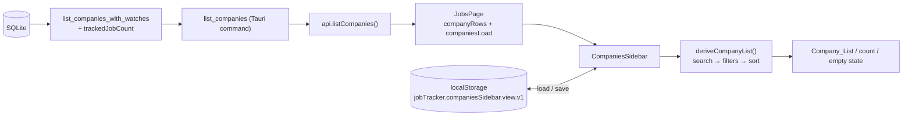
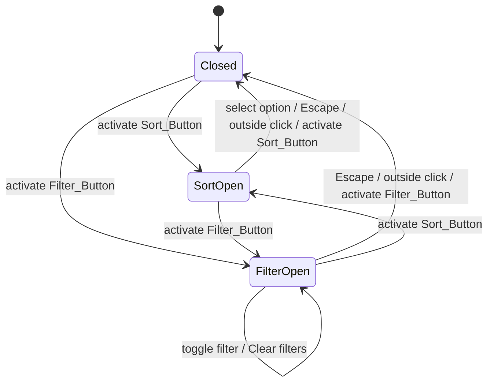

# Design Document

## Overview

This feature adds a Sort_Button and a Filter_Button next to the "Search companies…" input in the Jobs page Companies sidebar. Sorting, filtering, and search run in the desktop UI as pure functions over the `CompanyRow[]` that `list_companies` already returns. The backend gains one aggregate, `trackedJobCount`, computed in the same `list_companies_with_watches` call. The user's sort option and filter set persist in `localStorage`. Search text stays in memory only.

### Design goals and constraints

- No new IPC command, no Node/Next server, no CLI change. The only backend change is one extra `GROUP BY` query and one extra JSON field in `list_companies_with_watches` (`src-tauri/src/companies.rs`).
- All list logic (search, filter, sort, view-state parse/serialize, empty-state selection) lives in a new pure module `desktop/src/lib/company-sidebar.ts`. React code only wires state to it. This keeps every correctness property testable with fast-check without rendering.
- The sidebar never reads or writes URL search params, so `companyId` and every other param stay untouched (Req 5.7, 5.12, 7.3).
- Match existing patterns: the outside-click and Escape handling of the jobs Filter_Popover in `JobsPage.tsx`, `SidebarLink` (it already accepts a `count` prop), and the `localStorage` usage in `ThemeContext.tsx`.

### Research summary

- `companies.rs::list_companies` orders by `ORDER BY name` (SQLite binary collation, case-sensitive). That order is kept unchanged for the service (Req 4.6). The UI re-sorts using Name_Order.
- `list_companies_with_watches` already loads watches, pending reviews, and `openPositionCount` with one query each and joins them in memory with a `HashMap`. Tracked counts use the same shape.
- `jobs.company_id` is `TEXT NOT NULL REFERENCES companies(id)` (`db/migrate.rs`), so every job links to exactly one company. `archived` is a value of `jobs.status` (`models.rs`), not a separate column. Tracked_Job_Count is therefore `COUNT(*) ... WHERE status <> 'archived' GROUP BY company_id`. The `(company_id, updated_at)` index makes this cheap.
- `JobsPage.tsx` stores only `{ id, name }` per company (`setCompanies(companiesResult.companies.map((row) => row.company))`) and fetches companies inside the same `Promise.all` as the dashboard, so a companies failure is indistinguishable from a dashboard failure. Req 7.6–7.7 need a dedicated load status.
- Test tooling already present: `vitest` + `fast-check` 4.10.2 + `jsdom` (per-file `// @vitest-environment jsdom`, see `JobsPage.filters.test.tsx`) in `desktop/`; `proptest = "1"` in `src-tauri` dev-dependencies, plus an in-memory `test_connection()` helper in `companies.rs` tests.
- Name_Order uses `Intl.Collator(undefined, { sensitivity: "accent" })`. `"accent"` treats `A`/`a` as equal but keeps `a`/`á` distinct, which matches "case-insensitive". A single shared collator is much faster than repeated `localeCompare` calls on 10,000 rows ([MDN: Intl.Collator](https://developer.mozilla.org/en-US/docs/Web/JavaScript/Reference/Global_Objects/Intl/Collator)). Ties break on `id` with plain code-unit comparison, so the order is total and deterministic regardless of locale.
- The menus follow the WAI-ARIA menu button pattern (`aria-haspopup="menu"`, `aria-expanded`, `menuitemradio` / `menuitemcheckbox` with `aria-checked`) ([WAI-ARIA APG: Menu Button](https://www.w3.org/WAI/ARIA/apg/patterns/menu-button/)). Req 1.8 requires Tab/Shift+Tab traversal, so each item stays in the tab order (`tabIndex=0`), and ArrowUp/ArrowDown are added as a convenience.

## Architecture

### Data flow



### Layering

| Layer | File | Responsibility |
| --- | --- | --- |
| Service (Rust) | `src-tauri/src/companies.rs` | Add `trackedJobCount` to each row. No other change. |
| Types | `desktop/src/lib/schema.ts` | Add `trackedJobCount: number` to `CompanyRow`. |
| Pure logic | `desktop/src/lib/company-sidebar.ts` (new) | Sort, filter, search composition, view-state parse/serialize, storage wrappers, empty-state kind. |
| Component | `desktop/src/components/CompaniesSidebar.tsx` (new) | Search input, buttons, menus, list, count, empty states, focus management. |
| Page | `desktop/src/pages/JobsPage.tsx` | Keep full `CompanyRow[]`, track companies load status, render `CompaniesSidebar`. |

`filterCompaniesBySearch` in `job-filters.ts` stays as is and is reused for the search step.

### Interaction state machine (menus)



A single `openMenu: "sort" | "filter" | null` state guarantees at most one menu is open (Req 1.11).

## Components and Interfaces

### 1. `list_companies_with_watches` (Rust) — `src-tauri/src/companies.rs`

Add one query after the open-position counts, reusing the same pattern:

```rust
let mut tracked_stmt = conn
    .prepare("SELECT company_id, COUNT(*) FROM jobs WHERE status <> 'archived' GROUP BY company_id")
    .map_err(map_sqlite)?;
let tracked_job_counts: HashMap<String, i64> = tracked_stmt
    .query_map([], |row| Ok((row.get(0)?, row.get(1)?)))
    .map_err(map_sqlite)?
    .collect::<Result<_, _>>()
    .map_err(map_sqlite)?;
// per row:
"trackedJobCount": tracked_job_counts.get(&company.id).copied().unwrap_or(0)
```

- Counts any source, any `posting_state`, favorite or not, and includes `closed` (Req 4.2).
- Missing key → `0` (Req 4.3). `GROUP BY company_id` counts each job once (Req 4.4).
- Errors propagate with `?` before any row is built, so the caller gets `Err` and never a partial list. The function is read-only, so the database is unchanged (Req 4.7).
- Company order, `company`, `watches`, `reviews`, and `openPositionCount` are untouched (Req 4.6).

The `list_companies` command in `commands/mod.rs` needs no change. The CLI does not call this function for output that this feature changes.

### 2. `CompanyRow` type — `desktop/src/lib/schema.ts`

```ts
export type CompanyRow = {
  company: Company;
  watches: CompanyWatch[];
  reviews: CareersPageReview[];
  openPositionCount: number;
  trackedJobCount: number;
};
```

Existing fixtures and mocks that build `CompanyRow` (`desktop/src/lib/__fixtures__`, page tests) get `trackedJobCount: 0` added. `CompaniesClient.tsx` ignores the new field.

### 3. Pure module — `desktop/src/lib/company-sidebar.ts`

```ts
export const COMPANY_SORT_OPTIONS = [
  { value: "nameAsc", label: "Name A–Z" },
  { value: "nameDesc", label: "Name Z–A" },
  { value: "openPositionsDesc", label: "Most open positions" },
  { value: "trackedJobsDesc", label: "Most tracked jobs" },
  { value: "recentlyAdded", label: "Recently added" },
] as const;
export type CompanySortOption = (typeof COMPANY_SORT_OPTIONS)[number]["value"];
export const DEFAULT_COMPANY_SORT: CompanySortOption = "nameAsc";

export const COMPANY_FILTERS = [
  { value: "watched", label: "Watched" },
  { value: "hasOpenPositions", label: "Has open positions" },
  { value: "hasTrackedJobs", label: "Has tracked jobs" },
  { value: "needsAttention", label: "Needs attention" },
] as const;
export type CompanyFilter = (typeof COMPANY_FILTERS)[number]["value"];

export type CompanyViewState = {
  sort: CompanySortOption;
  filters: ReadonlySet<CompanyFilter>;
};
export const DEFAULT_COMPANY_VIEW_STATE: CompanyViewState;

/** Name_Order comparator: collator (sensitivity "accent"), then id by code unit. */
export function compareByNameOrder(a: CompanyRow, b: CompanyRow): number;

/** Returns a new array; never mutates input. Total order via id tie-break. */
export function sortCompanies(rows: readonly CompanyRow[], sort: CompanySortOption): CompanyRow[];

export function matchesCompanyFilter(row: CompanyRow, filter: CompanyFilter): boolean;
/** Conjunction of all filters; empty set returns rows unchanged (same elements, same order). */
export function applyCompanyFilters(rows: readonly CompanyRow[], filters: ReadonlySet<CompanyFilter>): CompanyRow[];

export type DerivedCompanyList = {
  visible: CompanyRow[];   // searched, filtered, sorted
  total: number;           // rows.length (M)
  isRefined: boolean;      // filters.size > 0 || search.trim() !== ""
};
export function deriveCompanyList(
  rows: readonly CompanyRow[],
  search: string,
  view: CompanyViewState,
): DerivedCompanyList;

/** Value shown next to a name, or null when the sort has no count. */
export function sortCountFor(row: CompanyRow, sort: CompanySortOption): number | null;

export function toggleCompanyFilter(view: CompanyViewState, filter: CompanyFilter): CompanyViewState;
export function clearCompanyFilters(view: CompanyViewState): CompanyViewState;

export const COMPANY_VIEW_STORAGE_KEY = "jobTracker.companiesSidebar.view.v1";
export function serializeCompanyViewState(view: CompanyViewState): string;
/** Never throws. Invalid sort → nameAsc; keeps valid, de-duplicated filters only. */
export function parseCompanyViewState(raw: string | null): CompanyViewState;
/** Never throws; any storage error → DEFAULT_COMPANY_VIEW_STATE. */
export function loadCompanyViewState(storage: Pick<Storage, "getItem"> | undefined): CompanyViewState;
/** Never throws; returns false when the write failed. */
export function saveCompanyViewState(storage: Pick<Storage, "setItem"> | undefined, view: CompanyViewState): boolean;

export type CompanyEmptyState =
  | "loading" | "error" | "noCompanies" | "noSearchMatch" | "noFilterMatch" | null;
export function companyEmptyState(input: {
  load: "loading" | "ready" | "error";
  total: number;
  visibleCount: number;
  search: string;
  filterCount: number;
}): CompanyEmptyState;
```

Behavior details:

- `deriveCompanyList` runs `filterCompaniesBySearch` → `applyCompanyFilters` → `sortCompanies`. Search and filters are both per-row predicates (row-local, no cross-row state), so their order does not matter (Req 5.4). Sorting last keeps every remaining row exactly once (Req 5.3).
- `sortCompanies` comparators, each falling back to `compareByNameOrder`:
  - `nameAsc`: `compareByNameOrder(a, b)`.
  - `nameDesc`: `compareByNameOrder(b, a)` (exact reverse, including the id tie-break; Req 2.6).
  - `openPositionsDesc`: `b.openPositionCount - a.openPositionCount`.
  - `trackedJobsDesc`: `b.trackedJobCount - a.trackedJobCount`.
  - `recentlyAdded`: `createdAtMs(b) - createdAtMs(a)`, where `createdAtMs` is `Date.parse(createdAt)` and unparseable values become `-Infinity` (sorted last, then Name_Order). Equal timestamps use Name_Order.
  - Comparisons go through a `sign()` helper so `Infinity - Infinity` never yields `NaN`.
- `matchesCompanyFilter`:
  - `watched`: `row.watches.length > 0`
  - `hasOpenPositions`: `row.openPositionCount > 0`
  - `hasTrackedJobs`: `row.trackedJobCount > 0`
  - `needsAttention`: `row.watches.some((w) => w.consecutiveSyncFailures > 0) || row.reviews.length > 0` (`list_companies` returns only pending reviews).
- `serializeCompanyViewState` writes `{"version":1,"sort":…,"filters":[…]}` with filters in `COMPANY_FILTERS` order, so equal sets serialize identically.
- `companyEmptyState` precedence: `loading` → `error` → `noCompanies` (total 0) → `null` when `visibleCount > 0` → `noSearchMatch` when `search.trim() !== ""` → `noFilterMatch` when `filterCount > 0`.

### 4. `CompaniesSidebar` component — `desktop/src/components/CompaniesSidebar.tsx`

```ts
type CompaniesSidebarProps = {
  rows: CompanyRow[];
  load: "loading" | "ready" | "error";
  activeCompanyId: string | undefined;
  hrefForCompany: (companyId: string) => string; // JobsPage passes withCurrentSort(`/?companyId=${id}`)
};
```

Internal state:

- `search: string` — initial `""`, never persisted (Req 6.7).
- `view: CompanyViewState` — lazy `useState(() => loadCompanyViewState(safeLocalStorage()))`, so the first render already uses the restored state (Req 6.2).
- `openMenu: "sort" | "filter" | null`.
- Refs: `searchInputRef`, `sortButtonRef`, `filterButtonRef`, `sortMenuRef`, `filterMenuRef`.

`derived = useMemo(() => deriveCompanyList(rows, search, view), [rows, search, view])`. When JobsPage reloads `rows`, the same `view` is re-applied (Req 2.15, 3.11, 4.5).

State changes go through one helper so persistence happens synchronously inside the event handler, before React processes the next event (Req 6.1):

```ts
function commitView(next: CompanyViewState) {
  setView(next);
  saveCompanyViewState(safeLocalStorage(), next); // failure ignored; in-memory state kept (Req 6.6)
}
```

`safeLocalStorage()` returns `window.localStorage` inside a `try` and `undefined` if access throws.

Layout (Req 1.1, 1.2, 1.9):

```tsx
{load === "ready" && rows.length > 0 ? (
  <div className="mb-3 flex items-stretch gap-1.5">
    <input type="search" className="field min-w-0 flex-1 py-2 text-xs" aria-label="Search companies" … />
    <SortButton … />   {/* shrink-0 aspect-square; height stretches to the input */}
    <FilterButton … />
  </div>
) : null}
```

`items-stretch` with no explicit button height makes each button exactly as tall as the input. `min-w-0` lets the input shrink instead of wrapping.

Sort_Button:

- `aria-label="Sort companies"`, `aria-haspopup="menu"`, `aria-expanded={openMenu === "sort"}`, `aria-controls` = sort menu id.
- `aria-describedby` points to a visually hidden span: `Sorted by ${label}` (Req 2.11).
- A small accent dot renders only when `view.sort !== "nameAsc"`.
- Click: `setOpenMenu(openMenu === "sort" ? null : "sort")`. When it closes, focus stays on the button (Req 1.10). Opening from the filter menu just switches state (Req 1.11).

Filter_Button: same pattern with `aria-label="Filter companies"`. A numeric badge (`view.filters.size`) renders only when greater than 0, and the hidden description reads `${n} filters active` (Req 3.5).

Sort_Menu (`role="menu"`, absolutely positioned under the row):

- Five `button role="menuitemradio"` items in `COMPANY_SORT_OPTIONS` order with `aria-checked`, and a check icon on the active one (Req 2.1, 2.2).
- On open, a `useEffect` focuses the active item (Req 1.3).
- Select: if the value differs, `commitView({ ...view, sort })`. Always `setOpenMenu(null)` and focus `sortButtonRef` (Req 2.3, 2.4).

Filter_Menu (`role="menu"`):

- Four `button role="menuitemcheckbox"` items with `aria-checked` and a checkbox glyph (Req 3.1). On open, the first item gets focus (Req 1.4).
- Toggle: `commitView(toggleCompanyFilter(view, f))`. The menu stays open and focus stays on the item (Req 3.2).
- A separator, then "Clear filters" (`role="menuitem"`, `aria-disabled` when `filters.size === 0`). It stays focusable, and its handler returns early when disabled (Req 3.6, 3.9, 3.10).

Shared menu behavior (one `useEffect` keyed on `openMenu`, modeled on the jobs Filter_Popover):

- `pointerdown` outside the open menu and its button → `setOpenMenu(null)`. View state is unchanged (Req 1.6).
- `keydown` Escape → close, focus the opening button, `preventDefault` + `stopPropagation` (Req 1.5).
- ArrowUp/ArrowDown move focus among the menu's items. Tab/Shift+Tab use native order (Req 1.8).

List and count:

- Each visible row renders `<SidebarLink to={hrefForCompany(id)} active={activeCompanyId === id} label={name} count={sortCountFor(row, view.sort) ?? undefined} />` (Req 2.14, 5.8, 5.11). Only visible rows render, so a hidden active company marks nothing (Req 5.12). `SidebarLink` moves from `JobsPage.tsx` into a small shared export so both files can use it.
- When `derived.isRefined`, a `<p aria-live="polite">{visible.length} of {total} companies</p>` renders in the same render pass (Req 5.9, 5.10).

Empty states, from `companyEmptyState(...)`:

| Kind | Rendered |
| --- | --- |
| `loading` | Nothing (no message; Req 7.6) |
| `error` | `role="alert"` "Couldn't load companies." with zero links (Req 7.7) |
| `noCompanies` | "No companies yet." and no Reset (Req 7.1) |
| `noSearchMatch` | "No matching companies." + Reset button (Req 7.2) |
| `noFilterMatch` | "No companies match the selected filters." + Reset button (Req 7.4) |

Reset (`<button type="button">Reset</button>`, Req 7.5) runs in one handler: `setSearch("")`, `commitView(clearCompanyFilters(view))`, `searchInputRef.current?.focus()`. React batches these into one update, and the sort is kept (Req 7.3).

### UI Mockups

Text wireframes of the Companies card at sidebar width. `↕` is the sort icon, `▽` the funnel icon, `•` the active-sort dot, `▌` the active (selected) company. An interactive, theme-accurate version with a side-by-side gallery of these states is in [`mockup.html`](./mockup.html) (open it in a browser; design mockup only, not app code).

a. Default

```
╭────────────────────────────╮
│ Companies           Manage │
│ ┌────────────────┐┌──┐┌──┐ │
│ │Search compan…  ││↕ ││▽ │ │
│ └────────────────┘└──┘└──┘ │
│   Abby Care                │
│   Abridge                  │
│   Aerdos                   │
│   Airbase                  │
│   AKASA                    │
╰────────────────────────────╯
```

One row: search, Sort_Button, Filter_Button; Name A–Z, case-insensitive (Req 1.1, 1.2, 2.5, 2.10).

b. Sort_Menu open

```
╭────────────────────────────╮
│ Companies           Manage │
│ ┌────────────────┐┏━━┓┌──┐ │
│ │Search compan…  │┃↕ ┃│▽ │ │
│ └────────────────┘┗━━┛└──┘ │
│     ┌────────────────────┐ │
│     │ ✓ Name A–Z         │ │
│     │   Name Z–A         │ │
│     │   Most open posit… │ │
│     │   Most tracked jobs│ │
│     │   Recently added   │ │
│     └────────────────────┘ │
╰────────────────────────────╯
```

Five options, checkmark and focus on the active one (Req 1.3, 1.7, 2.1, 2.2).

c. Sort = Most tracked jobs

```
╭────────────────────────────╮
│ Companies           Manage │
│ ┌────────────────┐┌─•┐┌──┐ │
│ │Search compan…  ││↕ ││▽ │ │
│ └────────────────┘└──┘└──┘ │
│   Brightline             7 │
│   Granite AI             6 │
│   Fernway                4 │
│   AKASA                  3 │
│   Abby Care              2 │
╰────────────────────────────╯
```

Dot on Sort_Button; counts right-aligned, ties by Name_Order (Req 2.8, 2.11, 2.14).

d. Filter_Menu open, two filters checked

```
╭────────────────────────────╮
│ Companies           Manage │
│ ┌────────────────┐┌──┐┏━2┓ │
│ │Search compan…  ││↕ │┃▽ ┃ │
│ └────────────────┘└──┘┗━━┛ │
│     ┌────────────────────┐ │
│     │ ☑ Watched          │ │
│     │ ☑ Has open position│ │
│     │ ☐ Has tracked jobs │ │
│     │ ☐ Needs attention  │ │
│     │ ────────────────── │ │
│     │   Clear filters    │ │
│     └────────────────────┘ │
╰────────────────────────────╯
```

Badge "2"; menu stays open on toggle; "Clear filters" last (Req 1.4, 3.1, 3.2, 3.5, 3.6).

e. Filtered + search

```
╭────────────────────────────╮
│ Companies           Manage │
│ ┌────────────────┐┌──┐┌─2┐ │
│ │a               ││↕ ││▽ │ │
│ └────────────────┘└──┘└──┘ │
│  3 of 48 companies         │
│   Abby Care                │
│ ▌ AKASA                    │
│   Fernway                  │
╰────────────────────────────╯
```

Search and filters combine; count line; selected company highlighted (Req 5.1, 5.9, 5.11).

f. Empty and error states

```
╭────────────────────────────╮
│ Companies           Manage │
│ ┌────────────────┐┌──┐┌──┐ │
│ │zzz             ││↕ ││▽ │ │
│ └────────────────┘└──┘└──┘ │
│  0 of 48 companies         │
│  No matching companies.    │
│  Reset                     │
╰────────────────────────────╯
```

Search leaves nothing; controls stay visible (Req 7.2, 7.3, 7.5).

```
╭────────────────────────────╮
│ Companies           Manage │
│ ┌────────────────┐┌──┐┌─3┐ │
│ │Search compan…  ││↕ ││▽ │ │
│ └────────────────┘└──┘└──┘ │
│  0 of 48 companies         │
│  No companies match the    │
│  selected filters.         │
│  Reset                     │
╰────────────────────────────╯
```

Filters alone leave nothing (Req 7.4, 7.3, 7.5).

```
╭────────────────────────────╮
│ Companies           Manage │
│ ┌────────────────────────┐ │
│ │ Couldn't load          │ │
│ │ companies.             │ │
│ └────────────────────────┘ │
╰────────────────────────────╯
```

Load error: `role="alert"`, no controls, no links (Req 7.7).

Observation from the HTML mockup: at the 240px column with two 36px buttons, the input is about 116px wide, so the "Search companies…" placeholder truncates. The accessible name is unaffected. A shorter placeholder is an option if this reads poorly in the app.

### 5. `JobsPage.tsx` changes

- Replace `companies: {id,name}[]` with `companyRows: CompanyRow[]` and `companiesLoad: "loading" | "ready" | "error"` (initial `"loading"`).
- In `load()`, fetch companies separately from the dashboard so each failure is reported on its own:

```ts
const [dashboardResult, companiesResult] = await Promise.allSettled([
  api.getJobsDashboard(),
  api.listCompanies(),
]);
if (companiesResult.status === "fulfilled") {
  setCompanyRows(companiesResult.value.companies);
  setCompaniesLoad("ready");
} else {
  setCompanyRows([]);
  setCompaniesLoad("error");
}
// dashboard branch keeps the existing setCounts / setActivity / setError / reportRefreshFailed behavior
```

- Remove `companySidebarSearch` and `visibleCompanies`. Render `<CompaniesSidebar rows={companyRows} load={companiesLoad} activeCompanyId={companyId} hrefForCompany={(id) => withCurrentSort(`/?companyId=${id}`)} />` inside the existing `<section className="card p-5">`, under the unchanged heading and Manage link.
- `load()` already runs after job mutations made in the GUI. CLI mutations show up on the next `load()` (mount or refresh), which satisfies Req 4.5 because rows are replaced wholesale.

## Data Models

### Persisted view state

Key: `jobTracker.companiesSidebar.view.v1` in `localStorage`.

```json
{ "version": 1, "sort": "trackedJobsDesc", "filters": ["watched", "needsAttention"] }
```

Parsing rules (`parseCompanyViewState`):

| Input | Result |
| --- | --- |
| `null` (no entry) | `{ sort: "nameAsc", filters: ∅ }` |
| Not valid JSON, or JSON that is not an object | default |
| `sort` missing or not one of the five values | `sort: "nameAsc"`; filters still parsed |
| `filters` not an array | `filters: ∅` |
| `filters` contains unknown values, non-strings, or duplicates | keep only known values, each once |
| `version` missing or different | parsed with the same rules (forward-tolerant) |

Search text is never stored.

### In-memory view state

`CompanyViewState.filters` is a `ReadonlySet<CompanyFilter>`. Toggling builds a new `Set`, so React sees a new reference. Equivalence for round-trip checks means the same `sort` and set equality of `filters`.

### Derived values (not stored)

| Value | Source |
| --- | --- |
| Visible rows | `deriveCompanyList(rows, search, view).visible` |
| Count text | `${visible.length} of ${rows.length} companies` when refined |
| Filter badge | `view.filters.size` |
| Sort indicator | `view.sort !== "nameAsc"` |
| Row count label | `sortCountFor(row, view.sort)` |

### Backend row (JSON)

```json
{
  "company": { "id": "…", "name": "…", "careersUrl": null, "createdAt": "…", "updatedAt": "…" },
  "watches": [ … ],
  "reviews": [ … ],
  "openPositionCount": 3,
  "trackedJobCount": 7
}
```

`trackedJobCount` is an `i64` from SQLite `COUNT(*)`, always ≥ 0.

## Correctness Properties

*A property is a characteristic or behavior that should hold true across all valid executions of a system-essentially, a formal statement about what the system should do. Properties serve as the bridge between human-readable specifications and machine-verifiable correctness guarantees.*

Redundant candidates were removed during reflection. 3.7 (subset) and 3.4 (no filters) follow from the filter model in Property 4. 4.3 and 4.4 follow from the exact count model in Property 12. 5.2, 5.3, 5.9, and 5.10 merge into the derive model in Property 7. The per-sort ordering checks (2.5, 2.7–2.9) merge into Property 1. 2.14 (count label) is a five-value lookup and is covered by example tests.

In the TS properties, generated `CompanyRow` lists use unique ids. Names come from a small alphabet with mixed case, accents, and duplicates, so ties and case folding are exercised. Counts range over 0–5 to force ties. `createdAt` draws from a few repeated ISO timestamps plus an invalid string. Watches have `consecutiveSyncFailures` in 0–2, and reviews number 0–2.

### Property 1: Sort order follows the option's key, then Name_Order

*For any* list of companies and any Sort_Option in {`nameAsc`, `openPositionsDesc`, `trackedJobsDesc`, `recentlyAdded`}, every adjacent pair `(a, b)` in `sortCompanies(rows, option)` satisfies: `a` has a key greater than or equal to `b`'s (`openPositionCount`, `trackedJobCount`, or parsed `createdAt` with invalid treated as oldest; no key for `nameAsc`), and when the keys are equal, `compareByNameOrder(a, b) < 0`.

**Validates: Requirements 2.5, 2.7, 2.8, 2.9**

### Property 2: Name Z–A is the exact reverse of Name A–Z

*For any* list of companies with unique ids, `sortCompanies(rows, "nameDesc")` equals the reverse of `sortCompanies(rows, "nameAsc")`.

**Validates: Requirements 2.6**

### Property 3: Sorting is a deterministic, idempotent permutation

*For any* list of 0 to 10,000 companies, any Sort_Option, and any shuffle `π` of the list: `sortCompanies(rows, o)` has the same length and the same multiset of ids as `rows`, `sortCompanies(sortCompanies(rows, o), o)` equals `sortCompanies(rows, o)`, `sortCompanies(π(rows), o)` equals `sortCompanies(rows, o)`, and the input array is not mutated.

**Validates: Requirements 2.12, 2.13**

### Property 4: Filters are a conjunction of the glossary predicates

*For any* list of companies and any subset `F` of the four Company_Filters, `applyCompanyFilters(rows, F)` equals `rows.filter((r) => [...F].every((f) => oracle(r, f)))` with input order preserved. The `oracle` is an independent implementation of the Glossary definitions. When `F` is empty, the result equals `rows`.

**Validates: Requirements 3.3, 3.4, 3.7**

### Property 5: Toggling flips exactly one filter

*For any* Company_View_State `v` and any Company_Filter `f`, `toggleCompanyFilter(v, f)` has the same `sort` as `v`, and its filter set differs from `v.filters` by exactly `{f}` (symmetric difference). Toggling twice returns a state equivalent to `v`.

**Validates: Requirements 3.2**

### Property 6: Filter activation order does not matter

*For any* list of companies, any set of Company_Filters `F`, and any two orderings of `F`, toggling the filters onto the default view in either order yields equivalent view states and identical `deriveCompanyList(rows, search, view).visible` for any search text.

**Validates: Requirements 3.8**

### Property 7: Derived list matches the search + filter + sort model

*For any* list of companies, any search string (including empty, whitespace-only, and mixed case), and any Company_View_State, `deriveCompanyList(rows, search, view)` satisfies:
- `visible` equals `sortCompanies(model, view.sort)`, where `model` keeps the rows whose lowercased name contains the trimmed, lowercased search (or every row when the trimmed search is empty) and that pass `oracle` for every active filter;
- every id in `visible` appears exactly once;
- `total === rows.length`;
- `isRefined === (view.filters.size > 0 || search.trim() !== "")`.

**Validates: Requirements 5.1, 5.2, 5.3, 5.9, 5.10**

### Property 8: Search and filters commute

*For any* list of companies, search string, and Company_Filter set `F`, `applyCompanyFilters(filterCompaniesBySearch(rows, s), F)` equals `filterCompaniesBySearch(applyCompanyFilters(rows, F), s)`. After sorting by any Sort_Option, both orders produce identical lists.

**Validates: Requirements 5.4**

### Property 9: View state persistence round trip

*For any* valid Company_View_State `v`, built from any Sort_Option and any sequence of filter toggles, `parseCompanyViewState(serializeCompanyViewState(v))` is equivalent to `v` (same sort, set-equal filters). Two equivalent states serialize to the identical string.

**Validates: Requirements 6.4**

### Property 10: Parsing stored state never fails and sanitizes

*For any* input `raw` (arbitrary strings, `null`, and JSON objects whose `sort` and `filters` fields are arbitrary JSON values, including unknown and duplicate filter strings), `parseCompanyViewState(raw)` does not throw and returns a state where `sort` is the stored value if it is one of the five Sort_Options and `nameAsc` otherwise, and `filters` equals the set of stored array elements that are known Company_Filters.

**Validates: Requirements 6.5, 6.3, 2.10**

### Property 11: Empty-state selection follows the precedence rule

*For any* `load` in {`loading`, `ready`, `error`}, `total ≥ 0`, `0 ≤ visibleCount ≤ total`, search string, and `filterCount` in 0–4, `companyEmptyState(...)` returns: `loading` if loading; otherwise `error` if error; otherwise `noCompanies` if `total === 0`; otherwise `null` if `visibleCount > 0`; otherwise `noSearchMatch` if `search.trim() !== ""`; otherwise `noFilterMatch` (only reachable when `filterCount > 0`).

**Validates: Requirements 7.1, 7.2, 7.4, 7.6**

### Property 12: Tracked job count matches the non-archived job model

*For any* database state of 0–8 companies and 0–40 jobs, where each job has a random company, a `status` drawn from all job statuses (including `archived` and `closed`), a random source (including `greenhouse`, `lever`, `ashby`, and `manual`), a random `posting_state`, and a random favorite flag, every row from `list_companies_with_watches` has `trackedJobCount` equal to the number of that company's jobs with `status != "archived"` (0 when there are none). The sum over rows equals the total number of non-archived jobs.

**Validates: Requirements 4.1, 4.2, 4.3, 4.4**

### Property 13: Existing row fields and order are unchanged

*For any* database state generated as in Property 12, the rows from `list_companies_with_watches` appear in the same order as `list_companies(conn)`, and each row's `openPositionCount` equals the number of that company's jobs with `posting_state = 'active'` and a source in {`greenhouse`, `lever`, `ashby`}.

**Validates: Requirements 4.6**

## Error Handling

| Situation | Behavior |
| --- | --- |
| `list_companies` SQL error (any of the five queries) | `?` returns `AppError` before any row is built. No partial list. Read-only, so no database change (Req 4.7). |
| `api.listCompanies()` rejects in the UI | `companiesLoad = "error"`, `companyRows = []`. The sidebar shows "Couldn't load companies." (`role="alert"`) with zero links and no controls. The dashboard result is handled independently. The Preference_Store is not touched (Req 7.7). |
| Quiet refresh fails | Same as above for the sidebar. The existing `reportRefreshFailed` path for the dashboard is unchanged. |
| `localStorage` access or `getItem` throws | `loadCompanyViewState` returns defaults (`nameAsc`, no filters). Nothing is shown to the user (Req 6.6). |
| `setItem` throws (quota, disabled storage) | `saveCompanyViewState` returns `false`. The in-memory view state stays as selected (Req 6.6). |
| Stored JSON corrupt or containing unknown values | Sanitized by `parseCompanyViewState` (Req 6.5). The next write overwrites it with a clean value. |
| Unparseable `createdAt` | Treated as oldest for `recentlyAdded`, then Name_Order. Never `NaN` in comparisons. |
| Duplicate company ids in the response | Not expected (primary key). Sort stays stable via `Array.prototype.sort`, and React keys would warn. No special handling. |

## Testing Strategy

PBT applies here. The sort, filter, search composition, view-state codec, and empty-state selection are pure functions with large input spaces, and the backend aggregate can be checked against a simple model on an in-memory SQLite database.

### Libraries and configuration

- TypeScript: `fast-check` 4.10.2 with `vitest` (both already in `desktop/package.json`). Run with `npm test` in `desktop/` (`vitest run`).
- Rust: `proptest = "1"` (already a dev-dependency). Run with `cargo test` in `src-tauri/`, using the existing in-memory `test_connection()` helper in `companies.rs`.
- Each correctness property is implemented by a single property-based test with at least 100 iterations (`{ numRuns: 100 }` in fast-check, `ProptestConfig::with_cases(100)` in proptest). Property 3 uses a generator biased toward small lists, plus one run with a 10,000-row list to check the size bound and the time budget.
- Each property test carries a tag comment in this format:
  `// Feature: companies-sidebar-sort-filter, Property 1: Sort order follows the option's key, then Name_Order`

### Test files

| File | Contents |
| --- | --- |
| `desktop/src/lib/company-sidebar.test.ts` | Properties 1–11, plus unit examples: "Abby Care" < "AKASA" < "beta" for `nameAsc` (Req 2.5); `parseCompanyViewState(null)` defaults (Req 2.10, 6.3); `sortCountFor` for all five options (Req 2.14); load/save with a throwing storage (Req 6.6); `clearCompanyFilters` keeps sort (Req 3.9). |
| `desktop/src/components/CompaniesSidebar.test.tsx` (`// @vitest-environment jsdom`) | Example tests for the interaction and accessibility criteria listed below. |
| `desktop/src/pages/JobsPage.filters.test.tsx` (extended) or a new `JobsPage.companies.test.tsx` | URL preservation (Req 5.7, 5.8, 5.12, 7.3), error state when `listCompanies` rejects (Req 7.7), loading state (Req 7.6), reload keeps view state (Req 2.15, 3.11, 4.5). |
| `src-tauri/src/companies.rs` `mod tests` | Properties 12–13 (proptest), and an example for Req 4.7 (drop the `jobs` table on a test connection and assert `Err`). |

### Example and edge-case tests (component, jsdom)

- DOM order of search, Sort_Button, Filter_Button in one flex row with `items-stretch` and no fixed button height (Req 1.1, 1.2). Real wrapping and height are visual checks, verified manually in the running app.
- Open, close, and focus behavior: Sort opens and focuses the active option (1.3); Filter opens and focuses the first toggle (1.4); Escape closes and refocuses the button (1.5); outside `pointerdown` closes with unchanged state (1.6); re-clicking a button closes its menu (1.10); switching menus leaves one open (1.11).
- ARIA: names, `aria-expanded`, `aria-haspopup`, `menuitemradio` / `menuitemcheckbox` with `aria-checked`, exactly one checked sort item for each of the five options (1.7, 2.1, 2.2, 3.1).
- Keyboard: Tab reaches every item; Enter and Space activate (1.8, 7.5).
- Zero companies hides the controls and shows "No companies yet." with no Reset (1.9, 7.1).
- Selecting a sort closes the menu and refocuses the button; re-selecting the active one changes nothing (2.3, 2.4). Sort indicator dot and description (2.11). Filter badge count (3.5).
- Toggling keeps the menu open and focus on the item (3.2). "Clear filters" sits after the toggles, is `aria-disabled` with zero filters, and keeps sort and search (3.6, 3.9, 3.10).
- Persistence: a `setItem` spy is called inside the click handler, before the next event (6.1). A pre-seeded store applies on first render with no flash of default order (6.2). Search text is never written and starts empty (6.7).
- Search edits keep the view state; view changes keep search text, including whitespace (5.5, 5.6). Active company marking (5.11).
- Reset clears search and filters in one update, keeps sort, writes the store, and focuses the search input (7.3).

### Manual checks

Run `npm run dev` (`cargo tauri dev`) from the repo root yourself. Then check that the row does not wrap at the narrowest sidebar width, that the buttons are no taller than the input, and that VoiceOver announces the menu items' checked states. Full WCAG validation needs manual testing with assistive technologies.
