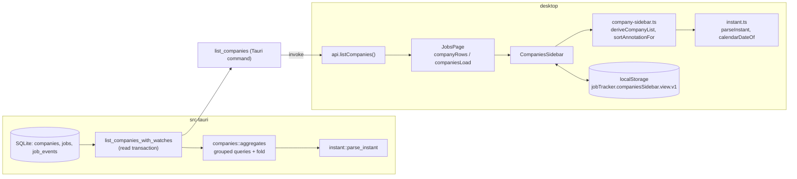
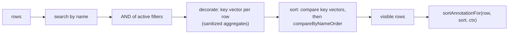

# Design Document: companies-tab-sorting

## Overview

This feature adds eight Sort_Options and two Company_Filters to the Jobs page Companies_Sidebar. All new orderings use per-company pipeline aggregates that the Rust Company_Data_Service (`list_companies_with_watches` in `src-tauri/src/companies.rs`) computes and attaches to every `CompanyRow`. The desktop UI (`desktop/src/lib/company-sidebar.ts`, `desktop/src/components/CompaniesSidebar.tsx`) sorts, filters, and annotates over those rows with the existing pure-function pattern and the Name_Order tie-break (`compareByNameOrder`).

New `CompanyRow` fields:

| Field | Type | Source |
| --- | --- | --- |
| `wishlistJobCount` | integer ≥ 0 | Wishlist_Job_Count |
| `appliedJobCount` | integer ≥ 0 | Applied_Job_Count |
| `interviewingJobCount` | integer ≥ 0 | Interviewing_Job_Count |
| `lastActivityAt` | string \| null | Last_Activity_At (stored string, verbatim) |
| `lastAppliedAt` | string \| null | Last_Applied_At (stored string, verbatim) |
| `wishlistEaseAverage` | number \| null | Wishlist_Ease_Average (unrounded) |

New Sort_Options: `wishlistJobsDesc`, `wishlistJobsAsc`, `appliedJobsDesc`, `appliedJobsAsc`, `interviewingJobsDesc`, `recentActivity`, `recentlyApplied`, `easiestWishlist`. New Company_Filters: `hasWishlistJobs`, `hasAppliedJobs`. The `recentlyAdded` label changes to "Recently added company".

### Design goals and constraints

- Rust computes aggregates; the UI only orders and formats. No Node/Next server; data reaches the UI only through `api.listCompanies()` → Tauri `invoke("list_companies")`.
- Aggregates come from a fixed number of grouped queries (no per-company queries).
- Existing `CompanyRow` fields, company set, and company order stay identical (Req 1.9). Existing persisted view states keep working under the same key `jobTracker.companiesSidebar.view.v1` (Req 9.3, 9.4).
- `list_companies_with_watches` is called only by the `list_companies` Tauri command (`src-tauri/src/commands/mod.rs`). The CLI does not call it, so CLI output does not change.
- Rust and TypeScript must agree on what a Valid_Timestamp is and which instant it denotes. Both sides implement one small grammar and are checked against one shared fixture corpus.

### Research summary

- **Existing code.** `sortCompanies` decorates rows with one numeric key and sorts descending, then by `compareByNameOrder`. Filters are a conjunction over `COMPANY_FILTERS`. `serializeCompanyViewState` writes filters in `COMPANY_FILTERS` order, so appending new filters at the end leaves old serialized states byte-identical. `parseCompanyViewState` already falls back to `nameAsc` for unknown sorts and drops unknown filters, so Req 9.5–9.7 need no new parsing logic, only the larger option sets.
- **Pipeline definition.** `get_pipeline_counts` (`src-tauri/src/jobs/service.rs`) counts jobs with `is_new_from_watch = 0 AND (watch_disposition IS NULL OR watch_disposition != 'dismissed')`. Pipeline_Job adds `status <> 'archived'`. Observed `watch_disposition` values are `NULL`, `new`, `saved`, `dismissed`.
- **Background event types.** `src-tauri/src/ats/sync.rs` and `src-tauri/src/jobs/posting_check/persist.rs` write only `posting_state_changed` and `discovered_from_watch` to `job_events`. Excluding those two types gives User_Activity_Events (Req 1.12). User triage events such as `approved_from_watch` and `dismissed_from_watch` count as user activity.
- **Timestamp formats in the data.** `now_iso()` (`src-tauri/src/util.rs`) writes `YYYY-MM-DDTHH:MM:SS.sssZ`. `jt update --applied-at today` writes a date-only `YYYY-MM-DD` (`src-tauri/src/cli/handlers.rs`). CSV import can write arbitrary strings. So `applied_at` holds a mix of date-only and date-time values.
- **Why not SQL `MAX()` for the latest timestamp.** SQLite `MAX` on TEXT compares by bytes. That breaks for: values with non-`Z` offsets (`2026-10-01T09:00:00+09:00` is earlier than `2026-10-01T01:00:00Z` but sorts after it), invalid strings (`"pending"` sorts after every digit-led date), and `T` vs space separators. SQLite `julianday()` handles offsets but also accepts forms outside the requirement's grammar (for example `now`, bare Julian numbers) and loses sub-millisecond precision. The design therefore fetches candidate `(company_id, timestamp)` pairs with grouped, filtered SQL and selects the latest Valid_Timestamp in Rust.
- **Why not `Date.parse` in the UI.** ECMAScript parses an ISO date-time without an offset as **local** time and a date-only string as UTC, and implementations accept many non-ISO strings (`"March 4"`). Req 4.5 requires offset-less date-times to be treated as UTC, and the UI must agree with Rust's notion of validity. The UI uses its own strict parser. See [ECMAScript Date Time String Format](https://tc39.es/ecma262/#sec-date-time-string-format) and [MDN `Date.parse`](https://developer.mozilla.org/en-US/docs/Web/JavaScript/Reference/Global_Objects/Date/parse).
- **Date display.** `Intl.DateTimeFormat` with `{ month: "short", day: "numeric" }` plus optional `year: "numeric"` gives "Mar 4" / "Mar 4, 2025" in `en-US` and locale-appropriate forms elsewhere ([MDN `Intl.DateTimeFormat`](https://developer.mozilla.org/en-US/docs/Web/JavaScript/Reference/Global_Objects/Intl/DateTimeFormat)).
- **Test tooling.** `desktop` uses `vitest` (`npm test` = `vitest run`) with `fast-check` 4.10.2 and `jsdom` for component tests. `src-tauri` has `proptest = "1"` and `chrono` 0.4. Existing aggregate property tests live in the `companies.rs` test module. A cross-language fixture precedent exists: `desktop/src/lib/__fixtures__/run-contract-corpus.json` is read by `run-contract.test.ts` and by Rust (`src-tauri/src/runs/progress.rs`) via a `../desktop/...` path.

## Architecture

### Data flow



### Layering

| Layer | File | Responsibility |
| --- | --- | --- |
| Timestamp grammar (Rust) | `src-tauri/src/instant.rs` (new) | `parse_instant(&str) -> Option<DateTime<Utc>>`, `LatestTimestamp` fold |
| Aggregates (Rust) | `src-tauri/src/companies.rs` | Grouped queries, per-company fold, JSON row assembly |
| Shared fixture | `desktop/src/lib/__fixtures__/instant-corpus.json` (new) | Valid/invalid strings with expected instants, read by both test suites |
| Row type | `desktop/src/lib/schema.ts` | `CompanyRow` gains six fields |
| Timestamp grammar (TS) | `desktop/src/lib/instant.ts` (new) | `parseInstant`, `compareInstants`, `calendarDateOf`, `formatShortDate` |
| Pure sidebar logic | `desktop/src/lib/company-sidebar.ts` | Sort option table and groups, sort keys, sanitizers, filters, annotations, view-state codec |
| Component | `desktop/src/components/CompaniesSidebar.tsx` | Menu separators, scrollable Sort_Menu, annotation rendering |
| Row link | `desktop/src/components/SidebarLink.tsx` | Accept a text annotation plus an accessible label |
| Page | `desktop/src/pages/JobsPage.tsx` | Keep previous rows when a reload fails after a successful load |
| Styles | `desktop/src/index.css` | Sort menu width and scroll container |

### Sort pipeline

`deriveCompanyList` keeps its current order of steps: search → filters → sort. Because the comparator is a total order (every key vector ends with Name_Order, whose final tie-break is the unique `id`), sorting a filtered subset yields exactly the subsequence of the sorted full list. That satisfies Req 7.6 and is stronger than it requires.



## Components and Interfaces

### 1. Timestamp grammar (shared contract)

Valid_Timestamp is defined by this grammar. Both implementations accept exactly this language and nothing else. No leading or trailing whitespace is allowed, because stored strings are compared verbatim.

```
timestamp = date [ sep time [ offset ] ]
date      = YYYY "-" MM "-" DD          ; YYYY 0001–9999, MM 01–12, DD valid for month/year (leap years)
sep       = "T" / "t" / " "
time      = HH ":" mm [ ":" ss [ "." 1*9DIGIT ] ]   ; HH 00–23, mm 00–59, ss 00–59 (no leap second)
offset    = "Z" / "z" / ( "+" / "-" ) HH ":" mm     ; offset HH 00–23, mm 00–59
```

Instant rules (Req 1.3, 4.5):

- Date-only `YYYY-MM-DD` denotes 00:00:00 UTC on that date.
- Date-time without an offset is UTC.
- Date-time with an offset denotes local time minus the offset.
- Fractional seconds keep up to nanosecond precision.

All strings in this language are ASCII, so Rust byte order, Unicode code-point order, and JavaScript UTF-16 code-unit order agree on them. That makes the tie rule in Req 1.4 well defined on both sides.

### 2. `src-tauri/src/instant.rs` (new module, registered in `lib.rs`)

```rust
/// Parses a Valid_Timestamp per the grammar in design §1. None for anything else.
pub fn parse_instant(value: &str) -> Option<chrono::DateTime<chrono::Utc>>;

/// Running "latest Valid_Timestamp" selection for one group (Req 1.3, 1.4).
#[derive(Default)]
pub struct LatestTimestamp { best: Option<(DateTime<Utc>, String)> }

impl LatestTimestamp {
    /// Ignores invalid strings. Replaces the current best when the candidate's
    /// instant is later, or equal with a greater string by byte order.
    pub fn offer(&mut self, raw: &str);
    /// The stored string of the best candidate, verbatim.
    pub fn into_value(self) -> Option<String>;
}
```

The parser is a hand-written byte scanner that checks fixed positions and digit counts, then builds the value with `NaiveDate::from_ymd_opt` and `NaiveTime::from_hms_nano_opt` (these reject impossible dates such as `2026-02-30`), and applies the offset with `FixedOffset::east_opt`. It does not use `DateTime::parse_from_rfc3339` because RFC 3339 requires seconds and an offset, and chrono's RFC 3339 parser accepts inputs outside this grammar.

`offer` makes the result independent of row order: the selection is the maximum under the total order (instant, then string bytes). Repeated calls on the same database state return the same string (Req 1.4).

### 3. `list_companies_with_watches` changes (`src-tauri/src/companies.rs`)

The function keeps its signature (`AppResult<Vec<serde_json::Value>>`), its existing queries, and its company order (`list_companies`, `ORDER BY name`). It adds three read-only grouped queries and one read transaction.

**Pipeline predicate**, shared by all three queries as a `const` SQL fragment:

```rust
const PIPELINE_JOB_PREDICATE: &str = "j.status <> 'archived' \
    AND j.is_new_from_watch = 0 \
    AND (j.watch_disposition IS NULL OR j.watch_disposition <> 'dismissed')";
```

**Query A: counts and ease sums** (one row per company with Pipeline_Jobs):

```sql
SELECT j.company_id,
  SUM(j.status = 'wishlist'),
  SUM(j.status IN ('applied','interviewing','offer','rejected','withdrawn')
      OR (j.status = 'closed' AND j.applied_at IS NOT NULL)),
  SUM(j.status IN ('interviewing','offer')),
  SUM(CASE WHEN j.status = 'wishlist' AND typeof(j.application_ease) = 'integer'
            AND j.application_ease BETWEEN 1 AND 5 THEN j.application_ease ELSE 0 END),
  SUM(CASE WHEN j.status = 'wishlist' AND typeof(j.application_ease) = 'integer'
            AND j.application_ease BETWEEN 1 AND 5 THEN 1 ELSE 0 END)
FROM jobs j
WHERE {PIPELINE_JOB_PREDICATE}
GROUP BY j.company_id
```

Rust computes `wishlistEaseAverage = ease_sum as f64 / ease_count as f64` when `ease_count > 0`, otherwise `None`. Integer sum divided once gives the closest double to the exact mean (error far below 0.001), and the mean of values in 1..=5 lies in [1, 5] (Req 1.5). The `typeof`/`BETWEEN` guard is defensive: the column has a `CHECK (1..5)` constraint, but SQLite allows a REAL or TEXT value to bypass an INTEGER affinity in edge cases, and the requirement restricts the mean to integers 1–5.

Wishlist and applied predicates test disjoint `status` values, so each job counts toward at most one of them (Req 1.7). The interviewing statuses are a subset of the applied statuses (Req 1.8).

**Query B: applied timestamps.**

```sql
SELECT j.company_id, j.applied_at FROM jobs j
WHERE {PIPELINE_JOB_PREDICATE} AND j.applied_at IS NOT NULL
```

**Query C: user activity timestamps.**

```sql
SELECT DISTINCT j.company_id, e.occurred_at
FROM job_events e JOIN jobs j ON j.id = e.job_id
WHERE {PIPELINE_JOB_PREDICATE}
  AND e.type NOT IN ('posting_state_changed', 'discovered_from_watch')
```

`DISTINCT` drops duplicate timestamps per company before they cross into Rust. Both B and C stream rows into `HashMap<String, LatestTimestamp>` with `offer`, so memory is bounded by the number of companies, not events. For a personal tracker (thousands of jobs, tens of thousands of events) this is one sequential scan of `job_events` joined by primary key; the existing `job_events_job_id_type_idx` index covers the join.

**Consistency and failure.** All queries run inside `conn.unchecked_transaction()` (a deferred read transaction). The Tauri mutex in `with_db` already blocks in-process writers, but the hourly LaunchAgent (`jt --run-jobs`) is a separate process. The read transaction gives every query the same snapshot, so counts and timestamps describe one database state. The transaction is dropped without commit; no statement writes. Any `rusqlite` error propagates through `map_sqlite` and `?`, so the caller receives `Err` and no partial list (Req 1.10).

**Row assembly.** Each row adds the six fields with defaults for companies absent from the maps:

```rust
serde_json::json!({
    "company": company,
    "watches": company_watches,
    "reviews": company_reviews,
    "openPositionCount": open_position_count,
    "trackedJobCount": tracked_job_count,
    "wishlistJobCount": agg.wishlist,          // i64, default 0
    "appliedJobCount": agg.applied,            // i64, default 0
    "interviewingJobCount": agg.interviewing,  // i64, default 0
    "lastActivityAt": last_activity,           // Option<String>, default None → null
    "lastAppliedAt": last_applied,             // Option<String>, default None → null
    "wishlistEaseAverage": ease_average        // Option<f64>, default None → null
})
```

A private `struct CompanyPipelineAggregates` holds the per-company values, built by a pure helper `fold_pipeline_aggregates(counts, applied_pairs, activity_pairs)` so that the fold can be unit-tested without SQL.

### 4. `CompanyRow` type (`desktop/src/lib/schema.ts`)

```ts
export type CompanyRow = {
  company: Company;
  watches: CompanyWatch[];
  reviews: CareersPageReview[];
  openPositionCount: number;
  trackedJobCount: number;
  /** Pipeline_Jobs with status "wishlist". */
  wishlistJobCount: number;
  /** Pipeline_Jobs past wishlist (applied…withdrawn, or closed with applied_at). */
  appliedJobCount: number;
  /** Pipeline_Jobs with status "interviewing" or "offer". */
  interviewingJobCount: number;
  /** Latest user-activity event timestamp, stored string verbatim. */
  lastActivityAt: string | null;
  /** Latest applied_at, stored string verbatim. */
  lastAppliedAt: string | null;
  /** Mean application_ease of wishlist jobs (1–5), unrounded. */
  wishlistEaseAverage: number | null;
};
```

The type declares the backend contract. The sidebar logic still reads these fields through sanitizers (§6) because Req 3.10 and 5.5 require tolerating missing or malformed values.

### 5. `desktop/src/lib/instant.ts` (new)

```ts
/** Instant with nanosecond precision: epoch milliseconds plus 0–999_999 extra nanoseconds. */
export type Instant = { readonly ms: number; readonly subMsNanos: number };

/** Strict parser for the grammar in design §1. Returns null for any other input, including non-strings. */
export function parseInstant(value: unknown): Instant | null;

/** -1, 0, or 1 by (ms, subMsNanos). */
export function compareInstants(a: Instant, b: Instant): number;

export type CalendarDate = { readonly year: number; readonly month: number; readonly day: number };

/**
 * Calendar date a Valid_Timestamp displays as (Req 6.4): a date-only value keeps its
 * literal date; a date-time value uses its date in `timeZone` (default: the user's).
 */
export function calendarDateOf(value: string, timeZone?: string): CalendarDate | null;

/**
 * "Mar 4" or "Mar 4, 2025" in `locale`. The year appears only when it differs from
 * `now`'s year in `timeZone`. Always formats from the CalendarDate with timeZone "UTC",
 * so equal CalendarDates give identical strings (Req 4.7).
 */
export function formatShortDate(date: CalendarDate, now: Date, locale?: string, timeZone?: string): string;
```

Implementation notes:

- `parseInstant` matches one anchored regular expression for the grammar, checks ranges and days-in-month, and builds `ms` with `new Date(0)` + `setUTCFullYear(y, m - 1, d)` + `setUTCHours(h, mi, s, msPart)`. It does not use `Date.UTC(y, …)` directly, because `Date.UTC` maps years 0–99 to 1900–1999. Digits 4–9 of the fraction become `subMsNanos`. The offset is subtracted in minutes.
- `calendarDateOf` for a date-time value converts the instant to `timeZone` with `Intl.DateTimeFormat(…, { timeZone, year: "numeric", month: "numeric", day: "numeric" }).formatToParts`.
- `now` and `timeZone` are parameters so tests are deterministic. The component passes `new Date()` once per render and `undefined` for the user's zone.

### 6. Sidebar logic (`desktop/src/lib/company-sidebar.ts`)

#### Sort option table and groups

```ts
export const COMPANY_SORT_OPTIONS = [
  { value: "nameAsc", label: "Name A–Z", group: "name" },
  { value: "nameDesc", label: "Name Z–A", group: "name" },
  { value: "recentlyAdded", label: "Recently added company", group: "name" },
  { value: "openPositionsDesc", label: "Most open positions", group: "count" },
  { value: "trackedJobsDesc", label: "Most tracked jobs", group: "count" },
  { value: "wishlistJobsDesc", label: "Most wishlist jobs", group: "count" },
  { value: "wishlistJobsAsc", label: "Fewest wishlist jobs", group: "count" },
  { value: "appliedJobsDesc", label: "Most applied jobs", group: "count" },
  { value: "appliedJobsAsc", label: "Fewest applied jobs", group: "count" },
  { value: "interviewingJobsDesc", label: "Most interviews", group: "count" },
  { value: "recentActivity", label: "Recently updated job", group: "activity" },
  { value: "recentlyApplied", label: "Recently applied", group: "activity" },
  { value: "easiestWishlist", label: "Easiest wishlist to apply", group: "activity" },
] as const;
```

The component renders a separator wherever `group` changes between adjacent entries. With this table that yields exactly two separators, between `recentlyAdded`/`openPositionsDesc` and `interviewingJobsDesc`/`recentActivity` (Req 2.2). The group names are internal and never shown.

`CompanySortOption` stays derived from the table, so `isCompanySortOption` and `parseCompanyViewState` accept all 13 values and fall back to `nameAsc` for anything else (Req 2.6, 2.7, 9.5).

#### Filters

```ts
export const COMPANY_FILTERS = [
  { value: "watched", label: "Watched" },
  { value: "hasOpenPositions", label: "Has open positions" },
  { value: "hasTrackedJobs", label: "Has tracked jobs" },
  { value: "needsAttention", label: "Needs attention" },
  { value: "hasWishlistJobs", label: "Has wishlist jobs" },
  { value: "hasAppliedJobs", label: "Has applied jobs" },
] as const;
```

`matchesCompanyFilter` adds:

```ts
case "hasWishlistJobs": return wishlistCountOf(row) >= 1;
case "hasAppliedJobs":  return appliedCountOf(row) >= 1;
```

Appending keeps the serialized filter order for old states unchanged (Req 9.4). The badge count is `view.filters.size`, so it ranges 0–6 without code changes (Req 7.7).

#### Sanitizers (Req 3.10, 5.5, 4.8)

```ts
/** Whole number ≥ 0, else 0. Rejects NaN, ±Infinity, fractions, negatives, non-numbers. */
export function sanitizeCount(value: unknown): number;
/** Finite number in [1, 5], else null. */
export function sanitizeEase(value: unknown): number | null;
```

`wishlistCountOf`, `appliedCountOf`, `interviewingCountOf`, `easeOf`, `lastActivityOf` (= `parseInstant(row.lastActivityAt)`), and `lastAppliedOf` read through these. Existing `openPositionCount` and `trackedJobCount` reads are left as they are (Req 1.9, 6.8).

#### Sort keys

`sortCompanies` generalizes the existing decorate-sort-undecorate step. Each row gets a numeric key vector computed once; the comparator compares vectors element by element with the existing `sign` helper, then falls back to `compareByNameOrder`. `nameAsc` and `nameDesc` keep their existing comparator paths.

| Sort_Option | Key vector (smaller sorts first) |
| --- | --- |
| `recentlyAdded` | `[-createdAtMs]` (existing `Date.parse` behavior unchanged) |
| `openPositionsDesc` | `[-openPositionCount]` |
| `trackedJobsDesc` | `[-trackedJobCount]` |
| `wishlistJobsDesc` | `[-w]` where `w = wishlistCountOf(row)` |
| `appliedJobsDesc` | `[-a]` |
| `interviewingJobsDesc` | `[-i]` |
| `wishlistJobsAsc` | `w === 0 ? [1, 0] : [0, w]` |
| `appliedJobsAsc` | `a === 0 ? [1, 0] : [0, a]` |
| `recentActivity` | `t === null ? [1, 0, 0] : [0, -t.ms, -t.subMsNanos]` where `t = lastActivityOf(row)` |
| `recentlyApplied` | same shape with `lastAppliedOf(row)` |
| `easiestWishlist` | `e === null ? [1, 0, 0] : [0, -e, -w]` where `e = easeOf(row)` |

Notes:

- The leading `1` places trailing groups (zero counts for the ascending sorts, null/invalid timestamps, null averages) after every other company. Inside a trailing group every remaining element is `0`, so Name_Order alone decides order (Req 3.4, 3.5, 4.2, 4.4, 5.4, 8.5).
- `easiestWishlist` compares the unrounded double (Req 5.2) and breaks equal averages with the full Wishlist_Job_Count, which includes wishlist jobs with null ease because Rust counts all wishlist jobs (Req 5.3).
- Under `wishlistJobsDesc` and `appliedJobsDesc`, zero counts sort last because `-0` is the largest key, with no special group (Req 8.5).
- For two companies with distinct counts both ≥ 1, the `Asc` key `[0, w]` and the `Desc` key `[-w]` give opposite orders. Equal counts fall through to Name_Order under both (Req 3.6, 3.7).
- `-0` and `0` compare equal under `sign`, which is what equal counts need.
- Rows are never mutated: decoration builds new wrapper objects, and the result is a new array (Req 8.4).

#### Annotations

```ts
export type SortAnnotation = {
  /** Visible text, e.g. "3", "Mar 4", "4.5". */
  text: string;
  /** Accessible label naming measure and value, e.g. "3 wishlist jobs". */
  label: string;
};

export type AnnotationContext = { now: Date; locale?: string; timeZone?: string };

/** Annotation for the active sort, or null when the sort has none or the value is null/invalid. */
export function sortAnnotationFor(row: CompanyRow, sort: CompanySortOption, ctx: AnnotationContext): SortAnnotation | null;

/** One decimal, halves away from zero: 4.25 → "4.3", 4 → "4.0". */
export function formatEase(value: number): string;
```

| Sort_Option | `text` | `label` |
| --- | --- | --- |
| `nameAsc`, `nameDesc`, `recentlyAdded` | none (null) | none |
| `openPositionsDesc` | `String(openPositionCount)` | "1 open position" / "N open positions" |
| `trackedJobsDesc` | `String(trackedJobCount)` | "1 tracked job" / "N tracked jobs" |
| `wishlistJobsDesc`, `wishlistJobsAsc` | `String(w)` (0 shown) | "1 wishlist job" / "N wishlist jobs" |
| `appliedJobsDesc`, `appliedJobsAsc` | `String(a)` (0 shown) | "1 applied job" / "N applied jobs" |
| `interviewingJobsDesc` | `String(i)` (0 shown) | "1 interview" / "N interviews" |
| `recentActivity` | `formatShortDate(calendarDateOf(lastActivityAt))` or null | "Last activity {text}" |
| `recentlyApplied` | same with `lastAppliedAt` | "Last applied {text}" |
| `easiestWishlist` | `formatEase(e)` or null | "Average ease {text}" |

The visible text for `openPositionsDesc` and `trackedJobsDesc` is the same number shown today (Req 6.8). Only an accessible label is added.

`formatEase(x)` computes `Math.round(x * 10 + 1e-9) / 10` and formats with `toFixed(1)`. The `1e-9` nudge exists because means such as 23/20 = 1.15 are not exactly representable (the double is 1.1499…), and plain `Math.round` would round them down. Values lie in [1, 5], so "away from zero" equals "half up". The nudge is far smaller than the 0.05 rounding step and far larger than double error at this magnitude (≈ 1e-15).

The existing `sortCountFor` export is removed; its only caller is `CompaniesSidebar`, and its tests move to `sortAnnotationFor`.

### 7. `CompaniesSidebar.tsx` changes

- **Separators.** While mapping `COMPANY_SORT_OPTIONS`, emit `<div role="separator" className="companies-sidebar-sep" />` before an option whose `group` differs from the previous option's. The separator has no `tabIndex` and no click handler. The existing arrow-key handler queries only `menuitemradio`/`menuitemcheckbox`/`menuitem` elements, so it already skips separators (Req 2.3).
- **Scrollable Sort_Menu (Req 2.5).** On open and on `window` `resize` while open, compute `maxHeight = window.innerHeight - sortButton.getBoundingClientRect().bottom - 6 - 8` (menu offset and bottom margin, in px; minimum 120) and set it as an inline style. The CSS class `companies-sidebar-menu--sort` adds `overflow-y: auto; overscroll-behavior: contain; width: 14rem;` (the longest label, "Easiest wishlist to apply", does not fit the current 12.5rem with the check column). Focus moves use `item.focus({ preventScroll: true })` followed by `item.scrollIntoView({ block: "nearest" })`, which scrolls the menu's own box just enough to show the whole item. The initial focus of the active item on open uses the same helper.
- **Annotations.** Replace `count={sortCountFor(row, view.sort) ?? undefined}` with `annotation={sortAnnotationFor(row, view.sort, ctx) ?? undefined}`. `ctx = { now: new Date() }` is created once per render inside the `useMemo` that maps visible rows, keyed on `derived.visible` and `view.sort`. Because annotations and order derive from the same `view` in the same render, a sort change updates both together (Req 6.10).
- **Filter menu.** No structural change; it maps the longer `COMPANY_FILTERS` table. Toggling still calls `commitView` and recomputes `derived` in the same render without calling the backend (Req 7.7).

### 8. `SidebarLink.tsx` changes

```ts
export type SidebarLinkProps = {
  to: string;
  label: string;
  count?: number;
  /** Text shown in the count slot, with a screen-reader label. Takes precedence over `count`. */
  annotation?: { text: string; label: string };
  active?: boolean;
  Icon?: …;
};
```

With `annotation`, the trailing slot renders `<span aria-hidden="true">{text}</span><span className="sr-only">{label}</span>`. The link's accessible name becomes, for example, "AKASA 3 wishlist jobs". Other callers that pass `count` are unaffected.

### 9. `JobsPage.tsx` change (Req 8.8)

Today a failed `listCompanies` sets `companyRows` to `[]` and `companiesLoad` to `"error"`. The new rule: if the previous load succeeded (tracked by a `companiesLoadedRef` set on success), a failure leaves `companyRows` and `companiesLoad` unchanged. The first load still shows the existing error state, so the prior spec's "listCompanies rejection shows the error state" test keeps passing. Sort and filters live in `CompaniesSidebar` state, which a failed reload never touches.

Successful reloads replace `companyRows` with the new array, and `deriveCompanyList` recomputes from it, so no aggregate from a previous load survives (Req 1.11, 3.11, 4.9, 8.6).

## Data Models

### Database (unchanged schema)

No migration. The feature reads existing columns:

| Table | Columns read |
| --- | --- |
| `jobs` | `company_id`, `status`, `applied_at`, `application_ease`, `is_new_from_watch`, `watch_disposition` |
| `job_events` | `job_id`, `type`, `occurred_at` |

### Backend row (JSON from `list_companies`)

```json
{
  "company": { "id": "…", "name": "Acme", "careersUrl": null, "createdAt": "…", "updatedAt": "…" },
  "watches": [],
  "reviews": [],
  "openPositionCount": 2,
  "trackedJobCount": 5,
  "wishlistJobCount": 3,
  "appliedJobCount": 2,
  "interviewingJobCount": 1,
  "lastActivityAt": "2026-10-03T17:22:05.120Z",
  "lastAppliedAt": "2026-09-28",
  "wishlistEaseAverage": 3.6666666666666665
}
```

Invariants per row: counts are integers ≥ 0; `wishlistJobCount + appliedJobCount ≤` Pipeline_Job count; `interviewingJobCount ≤ appliedJobCount`; `wishlistEaseAverage` is null or in [1, 5]; `lastActivityAt`/`lastAppliedAt` are null or a Valid_Timestamp copied from the database.

### Rust internal

```rust
#[derive(Default)]
struct CompanyPipelineAggregates {
    wishlist: i64,
    applied: i64,
    interviewing: i64,
    ease_sum: i64,
    ease_count: i64,
    last_activity: LatestTimestamp,
    last_applied: LatestTimestamp,
}
```

### Persisted view state (unchanged format)

Key `jobTracker.companiesSidebar.view.v1`, value `{"version":1,"sort":"<CompanySortOption>","filters":[…]}` with filters in `COMPANY_FILTERS` order. Old values with one of the original five sorts and a subset of the original four filters parse to the same state as before (Req 9.4). The search text is never stored (Req 9.9).

### Shared timestamp corpus

`desktop/src/lib/__fixtures__/instant-corpus.json`:

```json
{
  "valid": [
    { "input": "2026-10-01", "epochMs": 1790812800000, "subMsNanos": 0 },
    { "input": "2026-10-01T00:00:01Z", "epochMs": 1790812801000, "subMsNanos": 0 },
    { "input": "2026-10-01T09:00:00+09:00", "epochMs": 1790812800000, "subMsNanos": 0 },
    { "input": "2026-10-01 12:30", "epochMs": 1790857800000, "subMsNanos": 0 },
    { "input": "2026-10-01T00:00:00.123456789Z", "epochMs": 1790812800123, "subMsNanos": 456789 }
  ],
  "invalid": ["", " 2026-10-01", "2026-02-30", "2026-13-01", "2026-10-01T24:00", "2026-10-01T23:59:60Z",
              "2026-10-01T00:00:00.1234567891Z", "2026-10-01T00:00+0900", "March 4", "now", "0000-01-01"]
}
```

The `epochMs` values above were checked against `Date.parse` on the equivalent `Z` forms. The implementer extends the corpus with leap-day, year-boundary, lowercase `t`/`z`, and negative-offset cases. Rust reads the file with `include_str!("../../desktop/src/lib/__fixtures__/instant-corpus.json")` in a test, following the `run-contract-corpus.json` precedent. Vitest imports it as JSON.

## Correctness Properties

*A property is a characteristic or behavior that should hold true across all valid executions of a system-essentially, a formal statement about what the system should do. Properties serve as the bridge between human-readable specifications and machine-verifiable correctness guarantees.*

Reflection on the prework removed these redundancies:

- The ascending/descending "opposite order" criteria (3.6, 3.7) follow from the per-option ordering model, so they fold into Property 6 rather than a separate property.
- Requirement 8.7 (same data, same sequence) is a special case of determinism in Property 8.
- Requirements 5.2–5.4 are clauses of the `easiestWishlist` ordering and are covered by Property 6 with generators that include near-equal averages (4.6 vs 4.67) and wishlist jobs with null ease.
- Requirement 4.8 and 6.5 describe the same "invalid timestamp → no annotation, still listed" behavior; Property 11 covers the annotation, Property 8 covers "still listed".
- The prior spec's properties for filter toggling, filter-order independence, search/filter commutation, and empty-state precedence still apply. They are re-run with the six-filter domain instead of being restated here (see Testing Strategy).

### Property 1: Pipeline counts and ease average match the job model

*For any* database of companies and jobs with random `status` (all Job_Statuses), `applied_at` (null or a string), `application_ease` (null or 1–5), `is_new_from_watch` (0/1), and `watch_disposition` (null, `new`, `saved`, `dismissed`), every row returned by `list_companies_with_watches` SHALL have `wishlistJobCount`, `appliedJobCount`, and `interviewingJobCount` equal to the counts computed by a direct filter over the generated jobs using the glossary definitions; `wishlistEaseAverage` SHALL be null when the company has no wishlist Pipeline_Job with ease 1–5 and otherwise within 0.001 of the exact mean and inside [1, 5]; and `wishlistJobCount + appliedJobCount ≤ pipelineCount` and `interviewingJobCount ≤ appliedJobCount` SHALL hold. Companies with no Pipeline_Jobs SHALL have zeros and nulls.

**Validates: Requirements 1.1, 1.5, 1.6, 1.7, 1.8**

### Property 2: Latest timestamps match the instant model and ignore background events

*For any* database whose `applied_at` and `job_events.occurred_at` values are drawn from a pool of strings with known instants (date-only, `Z`, offset, offset-less, space separator, equal instants with different strings, and invalid strings), and whose event types include `posting_state_changed` and `discovered_from_watch`, each row's `lastAppliedAt` and `lastActivityAt` SHALL equal the stored string chosen by the model (latest valid instant among the company's Pipeline_Jobs, ties broken by the greatest string, user-activity event types only), or null when the model has no valid candidate. The returned value SHALL be byte-identical to a stored database value.

**Validates: Requirements 1.2, 1.3, 1.4, 1.12**

### Property 3: Latest-timestamp selection is order-independent

*For any* list of candidate strings (valid and invalid), feeding every permutation of the list into `LatestTimestamp::offer` SHALL produce the same result, equal to the maximum valid candidate under the order (instant, then string bytes), or None when no candidate is valid.

**Validates: Requirements 1.3, 1.4**

### Property 4: Existing row fields and order are unchanged

*For any* database generated as in Property 1, the sequence of company ids returned by `list_companies_with_watches` SHALL equal the order from `list_companies`, and `company`, `watches`, `reviews`, `openPositionCount`, and `trackedJobCount` SHALL equal the values defined by the prior spec's model (the existing Property 12 and Property 13 tests, run with the extended generator).

**Validates: Requirements 1.9**

### Property 5: Timestamp parsing round trip and cross-language agreement

*For any* valid calendar date (years 0001–9999), optional time with 0–9 fractional digits, separator (`T`, `t`, space), and optional offset (`Z`, `z`, `±HH:MM`), formatting the components into a grammar string and parsing it SHALL yield the instant computed independently from the components (date-only at 00:00:00 UTC, no offset treated as UTC). This SHALL hold for `parse_instant` in Rust and `parseInstant` in TypeScript, and both SHALL return the same instant (or both reject) for every entry of `instant-corpus.json`.

**Validates: Requirements 1.3, 4.5**

### Property 6: Each Sort_Option orders rows by its specification

*For any* list of `CompanyRow` values (with duplicate names, equal counts, equal instants, equal and near-equal ease averages, nulls, and invalid timestamps) and *for any* Sort_Option, `sortCompanies` SHALL produce the same id sequence as a reference implementation that applies the requirement text directly: count descending with Name_Order ties; ascending counts with zero-count companies trailing in Name_Order; newest valid instant first with null/invalid trailing in Name_Order; highest unrounded ease average, then higher full Wishlist_Job_Count, then Name_Order, with null averages trailing in Name_Order; and the unchanged rules for `nameAsc`, `nameDesc`, `recentlyAdded`, `openPositionsDesc`, `trackedJobsDesc`. In particular, two companies with distinct non-zero counts appear in opposite orders under the `Asc` and `Desc` variants, and companies with equal counts appear in Name_Order under both.

**Validates: Requirements 3.1, 3.2, 3.3, 3.4, 3.5, 3.6, 3.7, 4.1, 4.2, 4.3, 4.4, 4.6, 5.1, 5.2, 5.3, 5.4, 8.5**

### Property 7: Malformed aggregates are treated as their sanitized values

*For any* list of rows where the new count fields may be missing, null, negative, fractional, NaN, or ±Infinity, and `wishlistEaseAverage` may be missing, non-finite, or outside [1, 5], sorting, filtering, and annotating SHALL give the same results as for the same rows with each count replaced by 0 and each such average replaced by null, and every input row SHALL remain in the output.

**Validates: Requirements 3.10, 5.5**

### Property 8: Sorting is a deterministic, idempotent, non-mutating permutation

*For any* list of 0 to 10,000 rows (property runs use smaller sizes plus one large example) and *for any* of the 13 Sort_Options, `sortCompanies` SHALL return a list with the same multiset of ids as the input; sorting the output again SHALL return the identical id sequence; sorting any permutation of the input SHALL return the identical id sequence; and the input array order and every field of every input row SHALL be unchanged afterwards.

**Validates: Requirements 3.9, 8.1, 8.2, 8.3, 8.4, 8.7**

### Property 9: Derived list matches the search, six-filter, and sort model

*For any* rows, search text, Sort_Option, and subset of the six Company_Filters, `deriveCompanyList(rows, search, view).visible` SHALL equal the reference: rows whose name matches the search and that satisfy every active filter (with `hasWishlistJobs` ⇔ sanitized Wishlist_Job_Count ≥ 1 and `hasAppliedJobs` ⇔ sanitized Applied_Job_Count ≥ 1), each exactly once, sorted per Property 6.

**Validates: Requirements 3.8, 5.6, 7.3, 7.4, 7.5**

### Property 10: Filtering preserves strict relative order

*For any* rows, Sort_Option, and filter subset, if companies A and B are both visible and A precedes B strictly in `sortCompanies(rows, sort)`, then A SHALL precede B in the filtered visible list.

**Validates: Requirements 7.6**

### Property 11: Date annotations show the calendar date consistently

*For any* row and either `recentActivity` or `recentlyApplied`, `sortAnnotationFor` SHALL return null when the field is null or not a Valid_Timestamp, and otherwise text equal to `formatShortDate(calendarDateOf(value, tz), now, locale)` with label "Last activity {text}" or "Last applied {text}". *For any* two valid values with the same calendar date the texts SHALL be identical; *for any* date-only value the calendar date SHALL equal its literal `YYYY-MM-DD` parts in every time zone; and *for any* calendar date and `now`, the text SHALL contain the four-digit year if and only if the year differs from `now`'s year in the time zone.

**Validates: Requirements 4.7, 4.8, 6.4, 6.5**

### Property 12: Ease annotation rounds the exact mean half away from zero

*For any* integers n in 1..50 and k in n..5n, `formatEase(k / n)` SHALL equal the one-decimal string of the exact rational k/n rounded half away from zero (computed with integers as `floor((20k + n) / (2n)) / 10`), always with exactly one digit after the decimal point.

**Validates: Requirements 6.6**

### Property 13: Count annotations show the sanitized count with a pluralized label

*For any* row and count-based Sort_Option, `sortAnnotationFor` SHALL return text equal to the decimal string of the relevant count (sanitized for new counts, raw for `openPositionCount`/`trackedJobCount`), including "0", and a label "{n} {singular}" when n = 1 and "{n} {plural}" otherwise; *for any* row under `nameAsc`, `nameDesc`, or `recentlyAdded`, it SHALL return null; and under `easiestWishlist` the label SHALL be "Average ease {text}" or the annotation null when the average is null.

**Validates: Requirements 6.1, 6.2, 6.3, 6.7, 6.8, 6.9**

### Property 14: View-state persistence round trip is canonical and backward compatible

*For any* of the 13 Sort_Options and any subset of the six Company_Filters, `parseCompanyViewState(serializeCompanyViewState(state))` SHALL equal the state; two states with the same sort and filter set built by toggling in different orders SHALL serialize to identical strings; and *for any* state using one of the original five sorts and a subset of the original four filters, the serialized string SHALL equal the pre-feature serialization and parse back with no new filter active.

**Validates: Requirements 2.8, 9.1, 9.2, 9.4**

### Property 15: Stored view-state parsing never fails and sanitizes

*For any* string (random text, random JSON values, objects with random `sort` values and `filters` arrays containing unknown strings, non-strings, and duplicates), `parseCompanyViewState` SHALL not throw, SHALL return `nameAsc` when `sort` is not one of the 13 identifiers, SHALL keep each valid filter exactly once and drop the rest, SHALL keep the valid filters when only the sort is invalid, and SHALL return the default state for non-JSON or non-object input.

**Validates: Requirements 2.7, 9.5, 9.6, 9.7**

## Error Handling

| Situation | Behavior | Requirement |
| --- | --- | --- |
| Any aggregate query fails (missing table, I/O error, lock error) | `list_companies_with_watches` returns `Err` via `map_sqlite`; the read transaction is dropped; no rows are returned and nothing is written. The `list_companies` command rejects. | 1.10 |
| First `listCompanies` call rejects | Existing error state "Couldn't load companies." | prior spec |
| A later `listCompanies` reload rejects | `JobsPage` keeps the previous `companyRows` and `"ready"` status; the sidebar keeps its order, Sort_Option, and filters. | 8.8 |
| A stored timestamp is unparseable | Rust skips it when selecting the latest value; if the UI still receives one (for example from an older backend), `parseInstant` returns null and the company goes to the trailing group with no annotation. | 1.3, 4.2, 4.4, 4.8, 6.5 |
| A count is missing, null, negative, fractional, or non-finite | `sanitizeCount` returns 0 for ordering, filtering, and annotation; the company stays listed. | 3.10 |
| `wishlistEaseAverage` is non-finite or outside [1, 5] | `sanitizeEase` returns null; the company joins the null-average group. | 5.5 |
| `application_ease` in the database is not an integer 1–5 | Query A's guard excludes it from the sum and count. | 1.5 |
| Stored view state has an unknown sort, unknown or duplicate filters, invalid JSON, or storage throws | Existing tolerant parsing returns sanitized or default state; no error is shown. | 2.7, 9.5–9.7 |
| Writing view state fails | `saveCompanyViewState` returns false; the in-memory `view` stays applied. | 9.8 |
| `Intl.DateTimeFormat` receives an unsupported locale | `Intl` falls back to the default locale; formatting never throws for valid CalendarDates. | 6.4 |
| Window is too short for the Sort_Menu | Menu height is capped at the available space (minimum 120 px) and scrolls internally. | 2.5 |

## Testing Strategy

PBT applies to this feature: the aggregates are a function of database contents, and sorting, filtering, timestamp parsing, formatting, and the view-state codec are pure functions over large input spaces. UI layout and menu interaction use example-based component tests.

### Libraries and configuration

- **TypeScript:** `vitest` (`npm test` in `desktop/`, which runs `vitest run`) with `fast-check` 4.10.2. Component tests use `// @vitest-environment jsdom`, following `CompaniesSidebar.test.tsx`.
- **Rust:** `proptest = "1"` with `ProptestConfig::with_cases(100)`, run by `cargo test` in `src-tauri/`, following the existing tests in `companies.rs`.
- Each correctness property is implemented by a single property-based test with at least 100 iterations (`fc.assert(…, { numRuns: 100 })` or `with_cases(100)`).
- Each property test carries a tag comment in the form **Feature: companies-tab-sorting, Property {number}: {property_text}**, plus a `**Validates: Requirements X.Y**` doc line as in the existing tests.
- Do not write a custom PBT framework.

### Property test placement

| Property | File | Notes |
| --- | --- | --- |
| 1, 2, 4 | `src-tauri/src/companies.rs` tests | Extend `JobSpec` with `applied_at`, `application_ease`, `is_new_from_watch`, `watch_disposition`, and per-job events (type pool includes `created`, `status_changed`, `note_added`, `posting_state_changed`, `discovered_from_watch`). Timestamp pool entries are `(string, Option<expected_instant>)` written by hand so the model does not call the parser. |
| 3, 5 (Rust half) | `src-tauri/src/instant.rs` tests | Property 5 generates components, formats, and compares with a `chrono` value built from the components. A corpus test reads `instant-corpus.json` via `include_str!`. |
| 5 (TS half) | `desktop/src/lib/instant.test.ts` (new) | Same generator shape; expected `ms` from `setUTCFullYear`/`setUTCHours` on the components. Corpus test imports the JSON. |
| 6–10, 13–15 | `desktop/src/lib/company-sidebar.test.ts` | Extend the `row()` helper with defaults for the six new fields. The reference sort for Property 6 is a plain comparator written from the requirement text, separate from the key-vector implementation. Properties 14 and 15 extend the existing codec properties to the larger domains. |
| 11, 12 | `desktop/src/lib/instant.test.ts` and `company-sidebar.test.ts` | Property 11 uses fixed time zones (`UTC`, `America/Los_Angeles`, `Asia/Tokyo`, `Pacific/Kiritimati`) and the `en-US` locale. Property 12 computes the expected string with integer arithmetic. |

The prior spec's properties for toggling, filter-order independence, search/filter commutation, and empty-state precedence are kept and their generators widened to the six filters (covers Req 7.8, 7.9).

Generators should deliberately produce collisions: a small name pool with case and accent variants, counts in 0..3, ease averages from a short list (including 4.6 and 4.666…, and 4.25), the same instant written as `2026-10-01`, `2026-10-01T00:00:00Z`, and `2026-10-01T09:00:00+09:00`, and invalid strings.

### Example and edge-case tests

Rust (`companies.rs`):

- Dropping `job_events` (with `PRAGMA foreign_keys = OFF`) makes `list_companies_with_watches` return `Err`, and `jobs`/`companies` row counts are unchanged (Req 1.10).
- A company whose only jobs are archived, dismissed, or `is_new_from_watch = 1` returns zeros and nulls (Req 1.6).
- `closed` with `applied_at` counts as applied; `closed` without `applied_at` counts toward neither (glossary).
- Adding a `posting_state_changed` event with a later timestamp leaves `lastActivityAt` unchanged (Req 1.12).

TypeScript (`company-sidebar.test.ts`):

- `COMPANY_SORT_OPTIONS` values and labels equal the 13-entry list in Req 2.1; `COMPANY_FILTERS` equals the six-entry list in Req 7.1.
- 4.67 sorts above 4.6 under `easiestWishlist`, and both annotate as "4.7" and "4.6" (Req 5.2).
- `2026-10-01` orders before `2026-10-01T00:00:01Z` and ties with `2026-10-01T00:00:00Z` (Req 4.5).
- `formatEase(4.25) === "4.3"`, `formatEase(4) === "4.0"`, `formatEase(23 / 20) === "1.2"`.
- Labels: "1 wishlist job", "3 wishlist jobs", "0 applied jobs", "Last applied Mar 4", "Last activity Mar 4, 2025" (with `now` in 2026), "Average ease 4.5" (Req 6.7).

Component (`CompaniesSidebar.test.tsx`, jsdom):

- Sort_Menu renders 13 `menuitemradio` items in order and exactly two `role="separator"` elements at the specified positions; separators have no `tabindex` (Req 2.1, 2.2).
- Arrow keys move focus across the separator boundary without landing on a separator, and wrap (Req 2.3).
- For each of the 13 options, selecting it marks exactly that item `aria-checked="true"` and writes it to `localStorage` (Req 2.4, 2.8, 9.3).
- With `getBoundingClientRect` stubbed for a short window, the menu gets an inline `max-height` and `overflow-y: auto` class; arrow navigation calls `scrollIntoView({ block: "nearest" })` on the focused item (Req 2.5).
- Switching sort replaces annotations in the same render (Req 6.10). Rerendering with new `rows` reorders and reannotates without changing the sort or filters (Req 1.11, 3.11, 4.9, 8.6).
- Toggling `hasWishlistJobs`/`hasAppliedJobs` updates the list, "N of M companies", and the badge, with no `listCompanies` call; "Clear filters" deactivates all six and keeps sort and search (Req 7.2, 7.7, 7.8).
- A throwing `setItem` keeps the selected sort applied with no error UI (Req 9.8). Search text never appears in storage (Req 9.9).

Page (`JobsPage.companies.test.tsx`):

- First `listCompanies` rejection shows the error state (existing test).
- A successful load followed by a rejected reload keeps the previous list order, sort, and filters (Req 8.8).

### Manual checks

- In the packaged app against Application Support data, open the Sort_Menu in a short window and confirm it scrolls and the focused item stays visible.
- Check that "Easiest wishlist to apply" fits the menu width without wrapping in light and dark themes.
- Compare a few companies' counts against `jt list --search "<company>" --json` to confirm the pipeline definitions match expectations.
