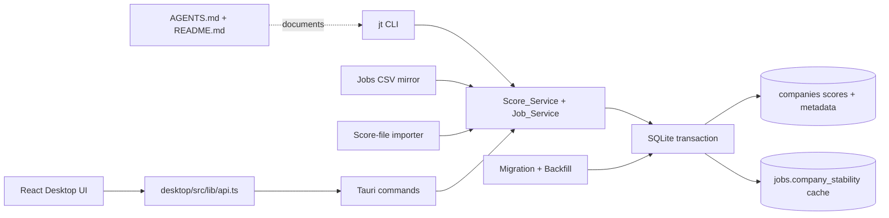

# Design Document: Company Employment Stability

## Overview

This feature moves employer scoring from the legacy per-job `jobs.company_stability` field to a company-owned score model and adds `employment_stability`. Each company owns two nullable integer scores from 1 to 5, their rationale, citations, scored-at timestamp, and source. Every job exposes both company scores; `jobs.company_stability` remains a synchronized compatibility cache, while employment stability has no job column.

The implementation stays inside the existing Tauri 2 architecture:

- Rust and SQLite in `src-tauri/` own persistence, transactions, migration, CSV synchronization, CLI behavior, and score-file import.
- Tauri commands are the only desktop transport. No HTTP server, Unix socket, MCP server, Node/Next server, or in-app LLM is added.
- React in `desktop/` renders company scores on jobs, boards, the company page, and the companies sidebar.
- The `jt` binary calls the same Rust services as IPC. CLI mutations refresh the CSV mirror.

The central design decision is to introduce a `Score_Service` with an explicit tri-state write request: omitted means preserve, JSON null means clear, and a value means set. All surfaces use it inside the caller's transaction. This prevents stale metadata, makes cache fan-out atomic, and gives job moves, CSV imports, and score-file imports identical semantics.

### Current-code findings that shape the design

The repository currently has the following relevant conventions:

- `src-tauri/src/db/migrate.rs` creates the schema with additive `ALTER TABLE` checks; there is no migration-version table.
- `app_settings(key, value, updated_at)` already persists durable one-time markers.
- `src-tauri/src/jobs/service.rs` owns `find_or_create_company`, job creation/update/delete/move, `JOB_COLUMNS`, list filtering, keyset paging, and empty-company cleanup.
- `src-tauri/src/companies.rs` returns JSON rows from `list_companies`; its existing stability average is derived from pipeline jobs and must be replaced by stored company scores.
- `src-tauri/src/jobs/csv.rs` has editable-field sidecar baselines, score-cell parsing, merge/overwrite modes, and export-after-import behavior.
- `src-tauri/src/cli/args.rs` already has strict company-stability parsing. It accepts ASCII digits and leading-zero forms such as `03`, and rejects signs, whitespace, decimals, empty values, and non-numeric text.
- `desktop/src/lib/api.ts` uses typed wrappers over `invoke`; `JobsPage` owns list filters and optimistic row updates; `CompanyDetailPage` loads a `CompanyRow`; `JobDetailClient` owns dirty-form and leave-warning behavior.
- Existing company-stability tests describe the old per-job behavior and should be converted to company-scoped behavior rather than retained as contradictory contracts.

## Architecture



### Transaction ownership

`Score_Service::write` receives an existing `&Transaction` or transaction-compatible connection and performs validation, company update, and company-stability cache fan-out before commit. It never updates job metadata, favorites, Appeal, Application_Ease, or job events. Callers choose the transaction boundary:

- A standalone IPC company score command opens one transaction.
- `update_job` opens one transaction containing company resolution, optional destination creation, job field changes, score write, cache update, and old-company cleanup.
- CSV row processing groups score decisions by company and uses one transaction per job/company operation as required by the existing importer; all score writes use the service.
- Score-file import uses one transaction per matched entry, so one failed entry rolls back only that company and its fan-out while later entries continue.

SQLite's write lock serializes concurrent writers. The service reads the company row and writes all score columns in one statement while holding the transaction, so concurrent writes are applied one at a time and cannot mix metadata from different requests.

## Components and Interfaces

### Schema and migration: `src-tauri/src/db/migrate.rs`

Extend new and existing `companies` tables with these nullable columns:

```sql
company_stability INTEGER CHECK (
  company_stability IS NULL OR
  (typeof(company_stability) = 'integer' AND company_stability BETWEEN 1 AND 5)
),
employment_stability INTEGER CHECK (
  employment_stability IS NULL OR
  (typeof(employment_stability) = 'integer' AND employment_stability BETWEEN 1 AND 5)
),
company_stability_rationale TEXT,
company_stability_citations TEXT,
company_stability_scored_at TEXT,
company_stability_scored_by TEXT CHECK (
  company_stability_scored_by IS NULL OR company_stability_scored_by IN ('manual','import')
),
employment_stability_rationale TEXT,
employment_stability_citations TEXT,
employment_stability_scored_at TEXT,
employment_stability_scored_by TEXT CHECK (
  employment_stability_scored_by IS NULL OR employment_stability_scored_by IN ('manual','import')
)
```

The creation SQL and each guarded `ALTER TABLE ... ADD COLUMN` use identical types and checks. The migrator refreshes `PRAGMA table_info(companies)` after each additive step, reports the named failed step, and does not mark a partially completed column as present. Existing values and all job columns remain untouched by column addition.

The migrator then runs a one-time backfill under a write transaction. It persists:

- `company_employment_stability_backfill_v1` in `app_settings` after successful backfill and conflict persistence.
- Backfill conflicts in a dedicated `company_stability_backfill_conflicts` table containing company id, company name, sorted distinct legacy values, reported flag, and timestamps. A unique company id prevents duplicate conflicts.

The marker and conflict rows commit with the backfill. A lock timeout or statement failure rolls back both. Later migrator runs skip all backfill work when the marker exists.

Backfill behavior is deterministic over all jobs, including archived, closed, new-from-watch, and dismissed jobs. One distinct non-null cache value becomes a company score with `manual` and a common backfill timestamp. Multiple distinct non-null values create an unresolved conflict and leave both company metadata and job cache values unchanged. Empty companies are included in marker creation and remain eligible for later scores.

### Domain models: `models.rs` and a new score module

Add a `CompanyScore`/`CompanyDetail` representation containing:

```rust
pub struct CompanyScores {
    pub company_stability: Option<i64>,
    pub company_stability_rationale: Option<String>,
    pub company_stability_citations: Option<Vec<String>>,
    pub company_stability_scored_at: Option<String>,
    pub company_stability_scored_by: Option<String>,
    pub employment_stability: Option<i64>,
    pub employment_stability_rationale: Option<String>,
    pub employment_stability_citations: Option<Vec<String>>,
    pub employment_stability_scored_at: Option<String>,
    pub employment_stability_scored_by: Option<String>,
}
```

The public company object embeds these fields with camelCase serialization. Citation columns remain JSON text in SQLite but always deserialize to arrays or null on JSON/IPC/CLI output.

`Job` and `JobSummary` retain a serialized `company_stability` value for compatibility and add `employment_stability`; both are populated by joining the job's company, not by trusting the cache. `jobs.company_stability` is updated only as the cache and is never used as the source for normal reads after backfill.

Define shared constants and validators:

- `COMPANY_RANGE_MESSAGE = "Company stability must be an integer from 1 to 5 (5 = most stable)"`.
- `EMPLOYMENT_RANGE_MESSAGE = "Employment stability must be an integer from 1 to 5 (5 = most secure)"`.
- Rationale normalization trims only the ends, counts Unicode code points after trim, maps empty to null, and preserves interior whitespace/newlines.
- Citation normalization trims every entry, preserves order and duplicates, maps an empty list to null, accepts 1–20 entries, and validates absolute `http`/`https` URLs with a non-empty host.

### Score_Service

Add a focused module, for example `src-tauri/src/company_scores.rs`, with:

```rust
pub struct ScoreWriteInput {
    pub company_stability: OptionalField<Option<i64>>,
    pub employment_stability: OptionalField<Option<i64>>,
    pub company_stability_rationale: OptionalField<Option<String>>,
    pub company_stability_citations: OptionalField<Option<Vec<String>>>,
    pub employment_stability_rationale: OptionalField<Option<String>>,
    pub employment_stability_citations: OptionalField<Option<Vec<String>>>,
    pub source: ScoreSource,                 // Manual | Import
    pub scored_at_override: Option<String>,  // importer as_of only
}
```

The service validates every supplied field before writing. A clear score clears all four metadata values for that score. Metadata supplied for a null score is rejected for manual writes; importer writes discard it and emit a warning. A changed score receives one timestamp shared by both scores in a combined write. Metadata-only writes preserve score timestamp/source. An unchanged score write preserves all stored score metadata but still performs company-stability cache fan-out if the request carried that field, including an equal value.

The update algorithm is:

1. Load the company under the transaction.
2. Normalize and validate all input, including citation-count precedence: more than 20 entries is reported before invalid-entry checks.
3. Compute the resulting values and whether each score is changed, metadata-only, cleared, or unchanged.
4. Reject rationale/citations attached to a manually null resulting score.
5. Update only changed company columns. Do not touch `updated_at` unless the existing company convention requires it; score timestamps are independent metadata.
6. If Company_Stability was carried, fan out the resulting value to every job for that company, including archived and closed jobs. The fan-out updates only `jobs.company_stability`; it changes no `updated_at`, event, status, notes, Appeal, Application_Ease, or favorite.
7. Return the complete company score object.

All failures occur before commit or roll back the transaction. The service exposes a summary classification (`applied`, `unchanged`, `warning`, `failed`) for CLI and importer reporting.

### Job lifecycle and `Job_Service`

Update `find_or_create_company` and all job insertion paths to leave new company score columns null. Existing Name_Match behavior remains trimmed, case-insensitive ASCII matching without fuzzy aliases. Existing companies retain all scores when resolved.

Update job queries and `JOB_COLUMNS` to join/select company scores. Inserts set the legacy cache from the resolved company's current Company_Stability in the same transaction. A job move resolves or creates the destination company transactionally, assigns the moved job's cache from the destination score, and only then cleans the old company. `delete_untracked_empty_company` must retain an empty company if either score is non-null; it may delete only when both scores are null and no watch/careers references exist.

`UpdateJobInput` uses tri-state fields for both scores and score rationale. If a request carries scores while changing `companyName`, it creates the missing destination company and applies the score to that destination in the same transaction. An invalid score is rejected before company creation. A missing job id returns `Job not found` without any company change.

`Job_Service` list filters add `min_employment_stability` alongside the existing company minimum. Both filters are conjunctive and exclude nulls. Job sorting adds `EmploymentStability`; company and employment sorts use `(is_null, score direction, job id)` with scored jobs first in both directions and keyset cursors. The page count query uses the same filters without the cursor.

### IPC and desktop API

Add Tauri commands:

- `update_job_cmd` accepts both score fields and delegates through the job transaction.
- `write_company_scores` accepts company id plus the tri-state score, rationale, and citations fields. Missing company returns `Company not found`.
- `list_companies` returns stored score fields and no `stabilityAverage` or `stabilityScoredJobCount`.
- `list_jobs_cmd`, `list_jobs_page_cmd`, and `list_job_ids_cmd` accept/validate both minimum filters.

Extend `desktop/src/lib/schema.ts` and `api.ts` with both job score fields, complete company score metadata, `minEmploymentStability`, the new sort field, and `writeCompanyScores`. Every serialized job includes both score keys even when null.

### CLI and score-file importer

Extend `ListArgs` with `--min-employment-stability` and `UpdateArgs` with:

- `--employment-stability`, `--clear-employment-stability`;
- `--company-stability-rationale`, `--clear-company-stability-rationale`;
- `--employment-stability-rationale`, `--clear-employment-stability-rationale`.

Use separate strict parsers with the exact scale messages. CLI parsing happens before opening SQLite. `03` is accepted for both score flags; signs, whitespace, decimals, empty values, and missing values are rejected. Clap conflict rules cover set/clear and rationale/clear combinations. If both score values are invalid, reporting the first encountered range error is sufficient.

Plain output replaces the old bare Stability line/column with `CO. STABILITY` and `EMP. STABILITY`, and full labels with the specified hints. JSON includes complete company metadata under `company`; citation lists are arrays or null. CLI score writes refresh the CSV mirror and do not favorite jobs or change Appeal/Application_Ease.

Add `scores import <path>` as a CLI subcommand. Implement planning separately from applying:

1. Read JSON, validate top-level object, `companies` array, and the 5000-entry cap before database writes.
2. Validate every entry before the first write. Ignore unmapped keys. Preserve zero-based entry positions.
3. Match `tracker_names` first; use `name` only when tracker names are absent, empty, or match no company. Matching is the existing trimmed case-insensitive Name_Match. Empty names match nothing.
4. Group all ambiguities and duplicate entries by company into one merged conflict record containing every entry and reason. No conflicted entry writes.
5. Build a plan containing applied, unchanged, unmatched, conflicts, invalid, warnings, and failed groups.
6. Without `--yes`, return the plan and write nothing. With `--yes`, apply valid matched entries in per-entry transactions through Score_Service. A failed entry rolls back only itself and continues.
7. Use valid `as_of` date/RFC3339 values as normalized scored-at; otherwise use import time and add one file-level warning. A second identical apply is entirely unchanged.
8. Refresh the CSV mirror after committed writes. A refresh failure leaves database commits intact and exits nonzero.

`--json` emits exactly one object with the required eight keys. `--quiet` emits only that object/plan. Human output reports conflict groups once, with company names and entry reasons. Backfill conflicts are reported once on ordinary non-quiet CLI commands, never on JSON/quiet/run-jobs output, and are marked reported only after successful printing.

### CSV mirror

Change the header to append `company_stability,employment_stability` immediately after `application_ease`. Export reads company-owned values, repeats them on every job row, and emits no metadata columns. Legacy files and sidecars without the employment column remain valid and preserve employment scores.

Extend `EditableFields` with presence flags for both score columns. Parse score cells with the existing trimmed integer parser: empty means null; optional `+` and leading zeroes are accepted; invalid cells skip the entire row and report the row number, field, and trimmed value.

In merge mode, a score cell is changed only if it differs from the sidecar baseline; for new/missing-baseline rows only non-empty cells count. For each company and score, changed cells must agree on one value, including blank as clear. Disagreement reports one company-level error listing all row numbers and writes neither score, while non-score fields still import. If the stored company value changed since baseline, the stored value wins and the row gets a conflict. Overwrite mode treats present cells as changed and follows the same company-agreement rule. Company moves count changed cells toward the destination company. After a real score write, export and rewrite sidecar baselines.

An unedited export/import round trip must preserve both scores, all metadata, cache values, Appeal, Application_Ease, and favorites.

### Desktop UI

Add shared score-select primitives and wrappers for Company and Employment scales. Compact row labels are `Company` and `Employment`; full labels and titles include the scale explanations. Update `JobsPage` list and `JobsBoardView` to show both values, omit null chips and separators, send only the changed score, optimistically update all loaded rows of the company, restore all affected rows on error, and refetch sidebar rows without reloading the jobs page. The row stays in place until the next reload.

Add both sort options on every Jobs tab, defaulting to descending on first selection. Add `minEmploymentStability` to filter draft, URL parsing, active-filter count, IPC requests, and clear-all behavior. Invalid URL values become Any without errors. The backend remains authoritative for filtered totals and keyset order.

`JobDetailClient` shows both company scores, company-wide helper text, a link to the company page, read-only rationale/citations, and only sends changed score fields. It preserves edits and dirty state after failed saves.

`CompanyDetailPage` renders a `CompanyScoresEditor` with two sections, score selects, rationale fields, citation add/remove controls, read-only local scored-at and source, 2000-character and 20-entry validation, clear-score notices, exact changed-field payloads, and the existing leave-page warning. Citation links open through the system browser convention already used by the app.

`CompaniesSidebar` sorts by stored Company_Stability and Employment_Stability, not averages or job cache values. Equal scores use `Name_Order`; nulls sort last. When the active sidebar sort targets an unscored score, the company has no annotation at all, even if the other score is present. Malformed values are treated as null without throwing.

### Documentation

Update `AGENTS.md` to describe company scope, both score scales, clear/rationale flags, importer mappings and exit rules, one-time Backfill_Conflict reporting, JSON metadata shapes, CSV refresh, and the fact that score operations do not favorite jobs or alter Appeal/Application_Ease. Update the Jobs CSV section of `README.md` with both columns, company repetition, blank/unscored behavior, baseline/conflict rules, and absence of metadata columns. Do not leave wording that calls Company_Stability a per-job score.

## Data Models

### Company score storage

| Concept | SQLite | JSON |
|---|---|---|
| Company score | nullable strict INTEGER 1–5 | integer or null |
| Rationale | nullable TEXT, normalized | string or null |
| Citations | nullable JSON array TEXT | array of URLs or null |
| Scored at | nullable UTC RFC3339 text | string or null |
| Scored by | nullable checked TEXT | `manual`, `import`, or null |

`companies` remains the identity source. `jobs.company_stability` is a denormalized cache and must equal `companies.company_stability` after every successful operation except unresolved backfill conflicts. Employment stability is never copied to `jobs`.

### Score-file mapping

`score`, `rationale`, `citations`, `employment_stability`, `employment_rationale`, and `employment_citations` map directly to the two score records. Omitted fields preserve stored values. JSON null clears the score or metadata according to the importer rules. `signals`, `employment_researched`, `jobs`, `job_ids`, `rubric`, and unknown fields are ignored.

### Backfill conflict

```text
company_stability_backfill_conflicts(
  company_id PRIMARY KEY,
  company_name,
  values_json,       -- ascending distinct legacy values
  reported,
  created_at,
  reported_at
)
```

### Job list query contract

```json
{
  "job": {
    "companyStability": 4,
    "employmentStability": null
  },
  "companyName": "Acme"
}
```

The keys are always present. `company` objects contain all ten company score fields, with citation arrays rather than encoded strings.

## Correctness Properties

*A property is a characteristic or behavior that should hold true across all valid executions of a system—essentially, a formal statement about what the system should do. Properties bridge requirements and executable correctness guarantees.*

The following properties are deliberately consolidated so each has distinct validation value.

### Property 1: Company schema migration is additive and idempotent

For any legacy company/job database missing any subset of the ten company score columns, migration SHALL add exactly one correctly constrained instance of each missing column, preserve all existing values and job columns, and make any later migration a no-op.

**Validates: Requirements 1.1, 1.2, 1.3, 1.4, 1.5, 1.6, 1.7, 1.8**

### Property 2: Company score writes preserve strict domain and metadata invariants

For any company and any score write, invalid typed/ranged scores or invalid sources SHALL fail atomically; after every successful write, a null score SHALL have null rationale, citations, scored-at, and scored-by, and every citation list SHALL be normalized and valid.

**Validates: Requirements 1.4, 1.5, 1.6, 1.7, 3.7, 3.8, 3.9, 3.10, 3.11, 3.12, 3.13, 3.18, 3.20**

### Property 3: Score metadata round-trips without unintended normalization

For any valid score, normalized rationale, and ordered valid citation list, writing and reading through Score_Service SHALL return equal score values, trimmed rationale, and citations in the same order, while preserving timestamps/source for metadata-only writes.

**Validates: Requirements 3.1, 3.3, 3.6, 3.7, 3.8, 3.9, 3.10, 3.11, 3.21**

### Property 4: Company stability cache fan-out is exact

For any database and any successful sequence of score writes, inserts, company moves, updates, and deletes, every remaining job's `company_stability` SHALL equal its company's Company_Stability, except jobs of unresolved Backfill_Conflict companies before a later Company_Stability write; jobs at other companies and all non-cache fields SHALL remain unchanged by fan-out.

**Validates: Requirements 2.1, 2.2, 2.3, 2.4, 2.5, 2.6, 2.8, 2.9, 3.16, 3.17**

### Property 5: Score and job transactions are atomic

For any request combining job fields, a company move, company creation, and one or both score writes, if any validation, company update, cache update, or job update fails, the database SHALL equal its pre-request state, including company creation/deletion, cache values, metadata, and job fields.

**Validates: Requirements 2.7, 5.4, 5.5, 5.6, 5.7, 5.9, 5.10, 5.11, 5.12, 5.13, 6.21, 6.22**

### Property 6: Backfill matches a reference model and is idempotent

For any set of companies and arbitrary legacy cache values, the first backfill SHALL score exactly companies with one distinct non-null value, preserve caches, persist exactly the multi-value conflicts, and a second run SHALL change nothing.

**Validates: Requirements 4.1, 4.2, 4.3, 4.4, 4.5, 4.6, 4.9, 4.12**

### Property 7: Strict CLI and IPC parsers accept only their specified values

For any string CLI score input, parsing SHALL succeed exactly for ASCII digit representations whose value is 1–5, including leading-zero forms; for any IPC JSON score value, validation SHALL accept only JSON integers 1–5 or null. The first encountered invalid dual-score CLI flag may determine the reported error.

**Validates: Requirements 5.6, 6.7, 6.8, 6.9, 7.15**

### Property 8: Nullable score ordering and paging match the reference

For any set of jobs, either score sort direction, page size, and valid filters, concatenating all keyset pages SHALL equal the reference order `(scored first, score ascending/descending, id ascending)` exactly once, and every page SHALL report the same filtered total.

**Validates: Requirements 6.10, 6.11, 6.12, 7.8, 7.9, 7.12, 7.13**

### Property 9: Minimum filters are pure conjunctive restrictions

For any job set and any active non-score filters, applying company and employment minimums SHALL equal the unfiltered result restricted to jobs meeting both thresholds, preserving relative order and total count.

**Validates: Requirements 6.10, 6.11, 6.12, 7.10, 7.11, 7.12, 7.13, 7.14, 7.15, 7.16, 7.17**

### Property 10: CSV score cells and unedited files round-trip

For any valid score or null, formatting then parsing SHALL return the same value and produce only one digit or an empty cell; exporting then importing an unedited file SHALL preserve scores, metadata, caches, job fields, and favorites without conflicts.

**Validates: Requirements 9.1, 9.2, 9.3, 9.4, 9.13, 9.14, 9.15, 9.16, 9.17**

### Property 11: CSV three-way merge is baseline-correct

For any baseline, CSV, and database score values, merge SHALL apply only CSV-only changes, retain the database value on concurrent changes with a conflict, and leave unchanged values alone; changed cells within one company must agree before a company write occurs.

**Validates: Requirements 9.5, 9.6, 9.7, 9.8, 9.9, 9.10, 9.11, 9.12**

### Property 12: Score-file planning is deterministic and idempotent

For any valid Score_File and unchanged database, a dry-run plan and a successful `--yes` plan SHALL classify the same entries, and running `--yes` twice SHALL classify every first-run write as unchanged on the second run with identical stored metadata.

**Validates: Requirements 10.1, 10.2, 10.3, 10.6, 10.7, 10.8, 10.10, 10.11, 10.13, 10.14, 10.15, 10.16, 10.17, 10.18, 10.21, 10.24, 10.25**

### Property 13: Import matching conflicts are merged per company

For any entries whose tracker names/name resolve ambiguously or whose multiple entries match one company, the importer SHALL emit one conflict group per affected company containing all relevant entries/reasons and SHALL write none of those entries.

**Validates: Requirements 10.11, 10.12, 10.13, 10.14**

### Property 14: Sidebar sorting sanitizes malformed scores and suppresses irrelevant annotations

For any list of company rows containing valid, null, missing, numeric-string, non-finite, fractional, or out-of-range scores, each active stability sort SHALL match a reference sort after malformed values become null; null target scores sort last and have no annotation, regardless of the other score.

**Validates: Requirements 11.1, 11.2, 11.3, 11.4, 11.5, 11.6, 11.7, 11.8, 11.9, 11.10, 11.11, 11.12, 11.13**

### Property 15: Score scope never changes posting scores or favorites

For any job/company state, any successful company score write, cache fan-out, importer operation, CSV score update, or UI score update SHALL leave Appeal, Application_Ease, favorite, status, notes, and job events unchanged.

**Validates: Requirements 2.3, 3.14, 3.16, 3.17, 6.18, 10.19, 12.5, 12.6, 12.7**

## Error Handling

- Invalid score values use the company or employment range message at the boundary that receives them.
- Citation lists over 20 entries fail before per-entry URL validation and name the 20-entry limit. This precedence is shared by IPC, CLI-backed service calls, CSV, and importer validation.
- Invalid rationale type, overlong rationale, invalid citation type/URL, and metadata attached to a null manual score reject the whole Score_Write.
- Missing job/company IDs return `Job not found` or `Company not found` without side effects.
- Cache fan-out, job move, destination company creation, and score writes roll back together on any SQLite error.
- Migration/backfill lock timeout rolls back the marker and all backfill changes; the next run retries.
- CSV invalid score cells skip only the row; company disagreement skips only that company's score writes while importing other fields and companies.
- Importer file-level errors occur before writes. Entry-level failures roll back one entry, appear under `failed`, and do not prevent later entries. A failed write or mirror refresh produces a nonzero exit status.
- JSON/quiet/run-jobs output never receives backfill conflict prose. Ordinary non-quiet CLI commands print each unreported conflict once and mark it reported only after successful output.
- UI save failures preserve edits and dirty state. Row-level failures restore every optimistically changed row for that company. Sidebar refetch failure keeps existing rows and shows no error.

## Testing Strategy

### Libraries and conventions

Use existing dependencies: Rust `proptest` for pure/service model properties and TypeScript `vitest` with `fast-check` for sidebar and URL logic. Use `Connection::open_in_memory()` plus `migrate()` for Rust service tests, temporary directories for CSV/CLI tests, and jsdom for React components. Do not create a custom property-testing framework.

Every property test runs at least 100 cases and includes a stable tag such as:

```text
Feature: company-employment-stability, Property 10: CSV score cells and unedited files round-trip
```

### Property tests

| Property | Suggested location | Test focus |
|---|---|---|
| 2–3 | `company_scores.rs` | generated rationales, Unicode length boundaries, URL arrays, null/metadata invariants |
| 4–6 | `jobs/service.rs`, `db/migrate.rs` | generated operation sequences, cache fan-out, migration snapshots, backfill reference model |
| 7–9 | `cli/args.rs`, `jobs/service.rs` | parser grammar, reference sort, keyset paging, conjunctive minimum filters |
| 10–11 | `jobs/csv.rs` | cell grammar, sidecar baseline matrix, company-level disagreement and round trip |
| 12–13 | importer planner module/tests | generated Score_Files, matching, dry-run parity, merged conflicts, idempotence |
| 14 | `desktop/src/lib/company-sidebar.sorting.test.ts` | malformed scores, filters, Name_Order, null annotation |
| 15 | service/CLI integration tests | snapshot all unrelated job fields before and after score operations |

### Example and integration tests

- Migration: fresh schema, legacy schema, each missing column, duplicate-run behavior, failed column addition, marker rollback, busy-lock retry.
- Score service: exact error text, citation-limit precedence, clear semantics, unchanged score timestamp preservation, same timestamp for dual score writes, concurrent two-connection writes.
- Job service: insert defaults, move to existing/new company, scored empty-company retention, invalid move rollback, no job event from fan-out.
- IPC/API: omitted versus null fields, JSON null presence, full company metadata shape, dirty mirror behavior.
- CLI: help text, first range error for dual-invalid values, conflicts, plain/JSON output, one-time Backfill_Conflict report, mirror refresh and exit status.
- CSV: header order/cell count, legacy files, invalid-row continuation, blank clear, company disagreement, stored-value-wins conflict, dry run.
- Importer: malformed top-level/file cap, invalid entry continuation, tracker-name precedence, merged conflict output, warnings for discarded metadata/as-of, per-entry rollback, exact JSON envelope.
- UI: both select option sets and titles, optimistic updates, failure restoration, company-wide helper text, changed-only payloads, citation/rationale validation, board null separators, sort/filter URL state, saved sidebar sort, and no annotation for an unscored active target.
- Documentation: targeted checks for every required flag, JSON field, CSV column, mapping, scale, and exit rule; review that no stale per-job company-stability description remains.

Run Rust tests with `cargo test` from `src-tauri/` and desktop tests with `npx vitest --run` from `desktop/`. Existing per-job company-stability tests should be rewritten to assert company scope; they must not remain as contradictory regression expectations.
