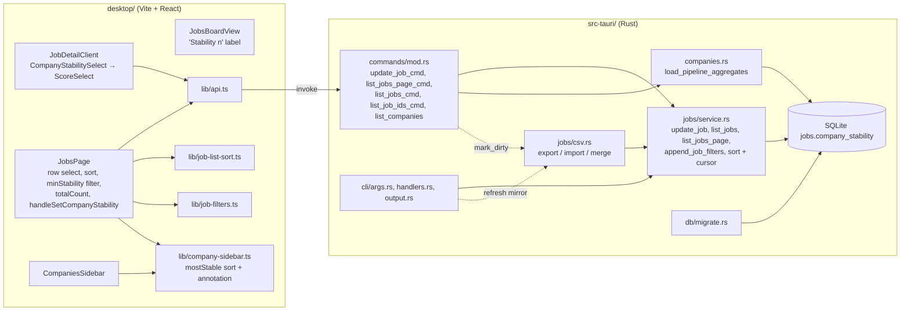
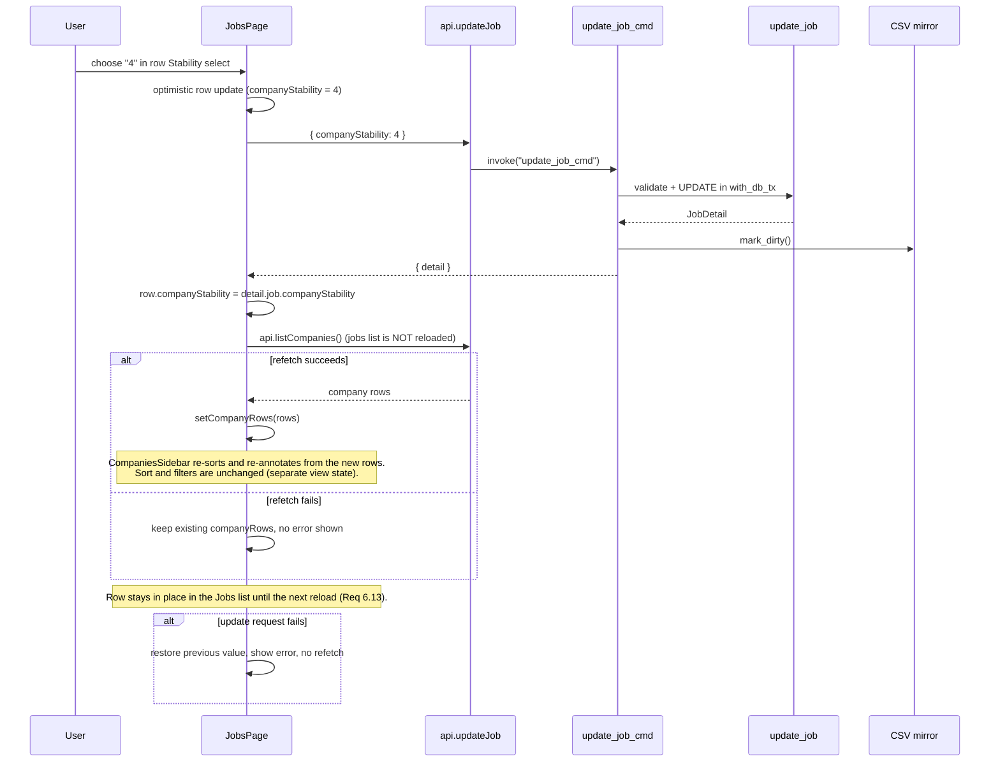

# Design Document: Company Stability Score

## Overview

Company_Stability is a third optional per-job score (1 = least stable, 5 = most stable, null = unscored). It copies the Appeal and Application_Ease design at every layer, so most of the work means adding a field in the places those scores already go. The new behavior beyond the copy:

- a Company_Stability sort field on the Jobs list (`sortBy=companyStability`), with nulls last and keyset paging;
- a Minimum_Stability_Filter on the Jobs list (`minStability=<n>`) and on `jt list` (`--min-company-stability <n>`);
- a `totalCount` on the paged Jobs list response, so the UI can show the filtered count (Req 7.13);
- a per-company Company_Stability_Average and a "Most stable company" sort in the Companies_Sidebar, refreshed with a company-rows refetch right after a successful in-app update (Req 9.13).

All backend logic stays in Rust (`src-tauri/`). The desktop UI talks to it only through Tauri `invoke` (`desktop/src/lib/api.ts`). Agents use the `jt` CLI. The design adds no HTTP API, MCP server, Node/Next server, or LLM features, as `AGENTS.md` requires.

### Research summary

The findings below come from reading the current code. They set the shape of the design.

| Area | Current Appeal / Application_Ease implementation | Consequence for Company_Stability |
| --- | --- | --- |
| Schema | `migrate.rs` creates `appeal` and `application_ease` in `CREATE TABLE jobs` and adds them to older DBs with an `ALTER TABLE ... ADD COLUMN ... CHECK (x IS NULL OR (x >= 1 AND x <= 5))` guarded by `PRAGMA table_info(jobs)`. No migration version table exists; column presence is the "applied" marker. | Same pattern. A single `ALTER TABLE ADD COLUMN` is atomic in SQLite, which covers Req 1.7. The CHECK adds `typeof(...) = 'integer'` so that `2.5` is rejected (the existing range-only CHECK accepts REAL 2.5). |
| Models | `models.rs`: `Job.application_ease: Option<i64>`, `JobSummary.application_ease`, `APPLICATION_EASE_RANGE_MESSAGE`, `checked_application_ease`. serde `rename_all = "camelCase"` emits `applicationEase: null` for `None`. | Add `company_stability` fields, `COMPANY_STABILITY_RANGE_MESSAGE`, and `checked_company_stability`. |
| Update | `UpdateJobInput.application_ease: Option<Option<i64>>` with `deserialize_optional_update` (missing = keep, null = clear, n = set). `update_job` validates every field before the single `UPDATE jobs SET ...`. `update_job_cmd` runs it in `with_db_tx` and then calls `csv_export.mark_dirty()`. | Same tri-state field. A dedicated deserializer turns non-integer JSON values into an error carrying the Stability_Range_Message (Req 2.5). The plain serde error would not contain that text. |
| Sort / paging | `JobListSortField::{AppliedAt, PostingDate, Appeal, CompanyName}`. `jobs_page_order_by` uses `(j.appeal IS NULL) ASC, j.appeal {dir}, j.id ASC`. `append_sort_spec_cursor` builds the keyset predicate from `JobListPageCursor.sort_value` (stringified score, or `None` for an unscored row) and `id`. Page size is the constant `JOB_PAGE_SIZE = 100`. | Add a `CompanyStability` variant with the same null-last ordering and cursor. Factor the Appeal cursor code into a helper shared by both nullable score columns. Add an internal page-size parameter so property tests can use sizes 1–100. |
| Filters | `JobFilters` + `append_job_filters` is shared by `list_jobs` (CLI), `list_jobs_page` (Jobs page), and `list_job_ids` (bulk select). `ListJobsArgs::into_filters` validates IPC input. | Add `min_company_stability: Option<i64>` to `JobFilters` and one SQL fragment. All three list paths get the filter. |
| CLI | `UpdateArgs.application_ease` uses `value_parser!(i64).range(1..=5)` and `conflicts_with`. `output.rs` prints an `EASE` column and an "Ease:" line. | Same flags, but with a custom value parser so the error text says "5 = most stable" (Req 3.4). Add `--min-company-stability` to `ListArgs`. |
| CSV | `CSV_HEADERS` ends with `application_ease`. `EditableFields` has `application_ease` + `application_ease_in_file` (`#[serde(skip)]`). `parse_score_cell(raw, label, hint)` produces `Invalid <label> '<value>'. ...`. The merge loop skips a score whose column is not in the file. Legacy sidecar JSON loads through `#[serde(default)]`. | Append `company_stability` after `application_ease`. Reuse `parse_score_cell` with label `company stability`, so the error contains "Invalid company stability" and the trimmed value (Req 4.6). |
| Companies | `companies.rs::load_pipeline_aggregates` runs one grouped query over `PIPELINE_JOB_PREDICATE` and computes the guarded `application_ease` sum/count for wishlist jobs. The row JSON carries `wishlistEaseAverage`. | Add a guarded `company_stability` sum/count over **all** Pipeline_Jobs (not only wishlist) in the same query. Emit `stabilityAverage` and `stabilityScoredJobCount`. |
| Sidebar | `company-sidebar.ts` is pure: `COMPANY_SORT_OPTIONS`, `sortKeyVector`, `sanitizeEase`, `formatEase` (one decimal, halves away from zero), `sortAnnotationFor`, and a view-state codec under `jobTracker.companiesSidebar.view.v1` that drops unknown sort values. | Add `mostStable` after `easiestWishlist` in the same group. The codec needs no change; old saved states never contain `mostStable` (Req 9.10). |
| Jobs page | `JobsPage.tsx` owns `companyRows` (from `api.listCompanies()` in `load()`) and has optimistic handlers `handleSetAppeal` / `handleSetApplicationEase`. `handleUpdateStatus` calls `load({ quiet: true })`, which reloads company rows and the jobs list. "Clear all" is a `<Link to="/">`. | Add `handleSetCompanyStability`. After success, it calls `api.listCompanies()` alone and stores the result with `setCompanyRows`, so the sidebar re-sorts at once without reloading the jobs list (Req 6.13, 9.13). "Clear all" already drops `minStability`. |
| Score selects | `AppealSelect.tsx` and `ApplicationEaseSelect.tsx` are line-for-line identical apart from the exported scale-label constant and the `OPTIONS` array: same props (`id`, `value`, `onChange`, `compact`, `disabled`), `aria-label` and `title` both set to the scale label, the same `stopPropagation` handlers, and the same class names. Their tests check `aria-label`, options, and emitted values only. `JobsPage` renders the visible "Appeal" / "Ease" text as a separate `<label htmlFor>` next to each compact select. | Extract a shared `ScoreSelect` that takes `scaleLabel` and `options`. `AppealSelect` and `ApplicationEaseSelect` become thin wrappers with unchanged exports and props, and `CompanyStabilitySelect` is a third wrapper. |
| Tests | Rust: `proptest = "1"` in dev-dependencies, already used in `jobs/service.rs` and `companies.rs`. Desktop: `vitest` + `fast-check 4.10.2`, with arbitraries in `desktop/src/lib/__fixtures__/company-row-arbitraries.ts`. | Use proptest for Rust properties and fast-check for TypeScript properties. No new test dependencies. |

### Key design decisions

1. **Per-job column, not per-company.** This follows the requirements and matches Appeal and Application_Ease. The company-level view is a derived average.
2. **Type-strict CHECK.** The new column uses `CHECK (company_stability IS NULL OR (typeof(company_stability) = 'integer' AND company_stability BETWEEN 1 AND 5))`. The plain range CHECK used by `appeal` accepts REAL `2.5`, which Req 1.5 forbids. SQLite applies INTEGER column affinity before the CHECK, so a text value that converts losslessly to an integer (for example `'3'`) is stored as integer `3`. Non-numeric text such as `'high'` and real-valued text such as `'2.5'` keep a non-integer type and are rejected. Existing columns are not changed.
3. **Validate at the trust boundary with the exact message.** Tauri deserializes `update_job_cmd` arguments before the command body runs. A `#[serde(deserialize_with = ...)]` function on `company_stability` reads a `serde_json::Value` and returns `D::Error::custom(COMPANY_STABILITY_RANGE_MESSAGE)` for anything that is not null or an integer. `update_job` then range-checks the integer with `checked_company_stability`. Rust callers (CSV import, tests) that build `UpdateJobInput` directly therefore get the same check.
4. **Shared nullable-score sort helper.** `ORDER BY (col IS NULL) ASC, col {ASC|DESC}, j.id ASC` and its keyset predicate go into one helper keyed by a static column name (`"j.appeal"` or `"j.company_stability"`). Only static column fragments reach the SQL text; values stay bound parameters.
5. **`totalCount` on every page.** `list_jobs_page` runs `SELECT COUNT(*)` with the same filter WHERE clause but without the cursor predicate, so the count is stable across pages. The Jobs page shows "N matching jobs" while any filter (including Minimum_Stability_Filter) or search is active. This is the smallest change that meets Req 7.13; no count display exists today.
6. **Company-rows refetch, not a full reload.** After a successful row-level stability update, `JobsPage` calls `api.listCompanies()` and passes the result to `setCompanyRows`. It does not call `load({ quiet: true })`, because that also reloads the jobs list and would move the row under the stability sort (Req 6.13). The server stays the only place that computes Company_Stability_Average, so the client needs no duplicate aggregation logic. The sidebar updates as soon as the refetch returns after the save (Req 9.13). Its sort and filters live in separate view state, so they do not change (Req 9.14). A refetch failure is ignored: the existing rows stay and no error is shown, because the score itself was saved. The next normal `listCompanies()` load also picks up CLI and CSV changes (Req 9.15). No live external-refresh mechanism is added.
7. **Strict CLI value parser.** `parse_company_stability(&str) -> Result<i64, String>` accepts only base-10 integers 1–5 and otherwise returns the Stability_Range_Message. clap reports it as `invalid value '<v>' for '--company-stability <N>': Company stability must be an integer from 1 to 5 (5 = most stable)` and exits with status 2 before any database access. `--min-company-stability` uses the same parser.
8. **Shared `ScoreSelect`.** The two existing score selects differ only in their label constant and options, so extracting the shared markup is mechanical. Their exported names, constants, props, and DOM output stay the same, so their existing tests pass unchanged.

## Architecture



### In-app stability change and sidebar update



## Components and Interfaces

### Rust backend

#### `src-tauri/src/db/migrate.rs`

- In `CREATE TABLE IF NOT EXISTS jobs`, add after `application_ease`:
  `company_stability INTEGER CHECK (company_stability IS NULL OR (typeof(company_stability) = 'integer' AND company_stability BETWEEN 1 AND 5)),`
- After the `has_application_ease` block, add a guarded `ALTER TABLE jobs ADD COLUMN company_stability INTEGER CHECK (...)` with the same CHECK. It runs only when `PRAGMA table_info(jobs)` lacks the column. Existing rows read back NULL. No default, no backfill.
- Failure behavior: the statement is a single atomic DDL. On error, `?` returns the error, the column stays absent (so the migration is not "applied"), and the next run retries.

#### `src-tauri/src/models.rs`

```rust
pub struct Job { /* ... */ pub company_stability: Option<i64> }
pub struct JobSummary { /* ... */ pub company_stability: Option<i64> }

pub enum JobListSortField { AppliedAt, PostingDate, Appeal, CompanyName, CompanyStability }
// serde camelCase wire value: "companyStability"

pub struct JobListPage {
    pub jobs: Vec<JobListSummary>,
    pub next_cursor: Option<JobListPageCursor>,
    pub total_count: i64, // serialized as "totalCount"
}

pub const COMPANY_STABILITY_RANGE_MESSAGE: &str =
    "Company stability must be an integer from 1 to 5 (5 = most stable)";

pub fn checked_company_stability(score: i64) -> Result<i64, &'static str>;
```

`Option<i64>` fields serialize `None` as `null` (no `skip_serializing_if`), which satisfies Req 2.1 and Req 3.7.

#### `src-tauri/src/jobs/service.rs`

- `JOB_COLS` / `map_job` / `JOB_COL_COUNT`: append `company_stability` as the last job column. Update `map_job` and `JOB_COL_COUNT` together. Callers that read `company_name` at index `JOB_COL_COUNT` keep working.
- `UpdateJobInput`:

  ```rust
  /// None = keep; Some(None) = clear; Some(Some(n)) = set (range-checked in update_job).
  #[serde(default, deserialize_with = "deserialize_company_stability_update")]
  pub company_stability: Option<Option<i64>>,
  ```

  `deserialize_company_stability_update` reads a `serde_json::Value`:
  - `Null` gives `Some(None)`.
  - A `Number` where `as_i64()` is `Some(n)` gives `Some(Some(n))`. `3.5` and `3.0` return `None` from `as_i64`, so they are rejected.
  - Anything else (string, bool, array, object, non-integer number) returns `Err(D::Error::custom(COMPANY_STABILITY_RANGE_MESSAGE))`.
- `update_job`: after the Application_Ease block, the same `match updates.company_stability { Some(next) => { if let Some(s) = next { checked_company_stability(s)?; } next } None => existing.company_stability }`. The `UPDATE jobs SET` statement gains `company_stability=?N`. All validation stays before the write, so a rejected request leaves `updated_at` and every other field unchanged (Req 2.5). `get_job_by_id(...).ok_or("Job not found")` already covers Req 2.11. Status, archive, restore, and `closed` changes go through paths that never touch `company_stability`. The archive and unarchive helpers write only `status` and timestamps.
- `JobFilters`: add `pub min_company_stability: Option<i64>`.
- `append_job_filters`: when `Some(n)`, append `" AND j.company_stability IS NOT NULL AND j.company_stability >= ?"` and bind `n`. This applies to `list_jobs`, `list_jobs_page`, `list_job_ids`, and the new count query, so the filter combines conjunctively with every other filter, the search text, and the tab (Req 7.10, 8.5).
- Sorting:
  - `jobs_page_order_by`: `(CompanyStability, Ascending)` gives `" ORDER BY (j.company_stability IS NULL) ASC, j.company_stability ASC, j.id ASC"`; `Descending` gives the same with `DESC` on the score. The field is valid on every tab, including applied, because the `AppliedAt`-only guard does not apply to it.
  - New helper used by both `Appeal` and `CompanyStability`:

    ```rust
    fn append_nullable_score_cursor(
        where_sql: &mut String,
        values: &mut Vec<Box<dyn ToSql>>,
        column: &'static str,          // "j.appeal" | "j.company_stability"
        direction: JobListSortDirection,
        cursor: &JobListPageCursor,
    ) -> AppResult<()>;
    // scored cursor  : AND (col IS NULL OR col {>|<} ? OR (col = ? AND j.id > ?))
    // unscored cursor: AND col IS NULL AND j.id > ?
    ```

  - `next_cursor.sort_value` for `CompanyStability` is `item.job.company_stability.map(|s| s.to_string())`.
- Paging:

  ```rust
  pub fn list_jobs_page(conn, filters, sort, sort_spec, cursor) -> AppResult<JobListPage> {
      list_jobs_page_sized(conn, filters, sort, sort_spec, cursor, JOB_PAGE_SIZE)
  }
  pub(crate) fn list_jobs_page_sized(..., page_size: usize) -> AppResult<JobListPage>;
  ```

  `list_jobs_page_sized` also runs `SELECT COUNT(*) FROM jobs j INNER JOIN companies c ON j.company_id = c.id{where_sql}`, building the WHERE clause from a second `job_filter_sql(&filters)` call without the cursor predicate, and returns it as `total_count`. The page SELECT adds `j.company_stability` to its projection and fills `JobSummary.company_stability`.

#### `src-tauri/src/commands/mod.rs`

- `ListJobsArgs`: add `pub min_company_stability: Option<serde_json::Value>`. In `into_filters`, a present value must be an integer number that passes `checked_company_stability`. Otherwise return `AppError::from(COMPANY_STABILITY_RANGE_MESSAGE)` before any query runs (Req 7.7). `Value::Null` is treated as absent. The validated value goes into `JobFilters.min_company_stability`.
- `update_job_cmd`, `list_jobs_page_cmd`, `list_jobs_cmd`, `list_job_ids_cmd`: signatures do not change. `update_job_cmd` already calls `csv_export.mark_dirty()` after a successful transaction (Req 2.9).

#### `src-tauri/src/cli/args.rs`

```rust
pub fn parse_company_stability(raw: &str) -> Result<i64, String>; // 1..=5 only, else the range message

// UpdateArgs
#[arg(long, conflicts_with = "clear_company_stability", value_parser = parse_company_stability,
      help = "Company stability from 1 (least stable) to 5 (most stable)")]
pub company_stability: Option<i64>,
#[arg(long, conflicts_with = "company_stability",
      help = "Clear the company stability score (leave the job unscored)")]
pub clear_company_stability: bool,

// ListArgs
#[arg(long, value_parser = parse_company_stability,
      help = "Only jobs with company stability >= N (integer 1-5, 5 = most stable); unscored jobs are excluded")]
pub min_company_stability: Option<i64>,
```

The `Update` command's `about` text gains "company stability". clap rejects values and conflicts during argument parsing with exit status 2, before `handlers.rs` opens a connection (Req 3.4, 3.5, 8.4). A missing value (`--min-company-stability` with nothing after it) is also a clap error.

#### `src-tauri/src/cli/handlers.rs`

- `handle_update`: `company_stability: if args.clear_company_stability { Some(None) } else { args.company_stability.map(Some) }`. Unknown ids fail in the existing `resolve_target_job_id` before any write (Req 3.6). The existing CLI CSV-mirror refresh after a successful update runs unchanged (Req 3.12). The non-JSON output prints `"  Stability: {n|—} (1-5, 5 = most stable)"`.
- `handle_list`: pass `args.min_company_stability` into `JobFilters.min_company_stability`. When the flag is absent the filter is `None`, so the SQL is unchanged (Req 8.2). An empty result prints `[]` with exit status 0 under `--json`.
- Other `UpdateJobInput { .. }` literals (for example the note handler) add `company_stability: None`.

#### `src-tauri/src/cli/output.rs`

- `format_jobs_table`: add a `STABILITY` header after `EASE`. The cell is the score or `—`.
- `format_job_detail`: add a `"  Stability:   {n} (1-5, 5 = most stable)"` line after `Ease:`, using `—` when unscored.

#### `src-tauri/src/jobs/csv.rs`

- `CSV_HEADERS`: append `"company_stability"` right after `"application_ease"` (it becomes the last column). Every data row writes the same number of cells.
- `EditableFields`: add

  ```rust
  #[serde(default)] pub company_stability: Option<i64>,
  #[serde(skip)]    pub company_stability_in_file: bool,
  ```

  `#[serde(default)]` lets sync sidecar JSON written before this feature load without error (Req 4.8).
- `EDITABLE_KEYS`: append `"companyStability"`. `field_norm` returns `fields.company_stability.map(|s| s.to_string())`.
- `parse_company_stability_cell(raw) = parse_score_cell(raw, "company stability", "5 = most stable")`. Error text: `Invalid company stability '<trimmed>'. Use an integer from 1 to 5 (5 = most stable), or leave blank`.
- Export: write `company_stability.map(to_string).unwrap_or_default()`, giving a single digit or an empty cell.
- Import row parsing: `company_stability_in_file = header_map.contains_key("company_stability")`. When true, parse the cell. A parse error skips the row (`summary.skipped += 1`), pushes `{row, message}`, and continues. When false, the value is `None` and `_in_file` is false.
- Merge loop: `if *field == "companyStability" && !csv_fields.company_stability_in_file { continue; }`. The existing three-way rule then applies: apply the CSV value when only the CSV changed since the baseline, record a conflict and keep the DB value when both changed (Req 4.7). The apply step sets `updates.company_stability = Some(csv_fields.company_stability)`.
- Create path: include `csv_fields.company_stability.is_some()` in the post-create `update_job` condition. A blank cell or a missing column leaves the new job unscored.

#### `src-tauri/src/companies.rs`

- `PipelineCountRow` / `CompanyPipelineAggregates`: add `stability_sum: i64`, `stability_count: i64`. The fold adds them per company.
- Query A gains two columns over all Pipeline_Jobs, with no status restriction:

  ```sql
  SUM(CASE WHEN typeof(j.company_stability) = 'integer'
            AND j.company_stability BETWEEN 1 AND 5 THEN j.company_stability ELSE 0 END),
  SUM(CASE WHEN typeof(j.company_stability) = 'integer'
            AND j.company_stability BETWEEN 1 AND 5 THEN 1 ELSE 0 END)
  ```

- `fn stability_average(&self) -> Option<f64> { (self.stability_count > 0).then(|| self.stability_sum as f64 / self.stability_count as f64) }`
- Row JSON adds `"stabilityAverage": stability_average` (unrounded, or null) and `"stabilityScoredJobCount": agg.stability_count`. Companies with no Pipeline_Jobs get `null` and `0` from `unwrap_or_default()`.

### Desktop UI

#### `desktop/src/lib/schema.ts` and `desktop/src/lib/api.ts`

- `Job.companyStability: number | null`. `JobSummary` (the `Pick<Job, ...>`) adds `"companyStability"`.
- `JobListSortField` adds `"companyStability"`. `JobListPage` adds `totalCount: number`.
- `CompanyRow` adds `stabilityAverage: number | null` and `stabilityScoredJobCount: number`.
- `JobFilters` (the api filter type) adds `minCompanyStability?: number`. `UpdateJobInput` adds `companyStability?: number | null` ("1–5, 5 = most stable; null clears").

#### `desktop/src/components/ScoreSelect.tsx` (new, extracted)

`AppealSelect` and `ApplicationEaseSelect` have the same body today. `ScoreSelect` holds that body unchanged, with the label and options as props:

```ts
export type ScoreOption = { value: "" | "1" | "2" | "3" | "4" | "5"; label: string; compact: string };
export function ScoreSelect(props: {
  id: string;
  value: number | null;
  onChange: (next: number | null) => void;
  compact?: boolean;
  disabled?: boolean;
  scaleLabel: string;               // used for aria-label and title
  options: readonly ScoreOption[];
}): JSX.Element;
```

It keeps the same event handling (`stopPropagation` on mouse down, click, and change, so a row click does not navigate; Req 5.11), the same `value ?? ""` mapping, and the same class names.

`AppealSelect` and `ApplicationEaseSelect` keep their file, exported names, scale-label constants, and props. Each becomes a one-line wrapper: `<ScoreSelect {...props} scaleLabel={APPEAL_SCALE_LABEL} options={OPTIONS} />`. The rendered DOM is identical, so `AppealSelect.test.tsx`, `ApplicationEaseSelect.test.tsx`, and their uses in `JobsPage` and `JobDetailClient` need no change.

#### `desktop/src/components/CompanyStabilitySelect.tsx` (new)

A thin wrapper over `ScoreSelect` with the same props as the other two selects (`id`, `value`, `onChange`, `compact`, `disabled`):

```ts
export const COMPANY_STABILITY_SCALE_LABEL = "Company stability (1–5, 5=most stable)";
export const COMPANY_STABILITY_OPTIONS = [
  { value: "",  label: "Unscored",          compact: "—" },
  { value: "1", label: "1 — least stable",  compact: "1" },
  { value: "2", label: "2", compact: "2" }, { value: "3", label: "3", compact: "3" },
  { value: "4", label: "4", compact: "4" },
  { value: "5", label: "5 — most stable",   compact: "5" },
] as const;
```

```tsx
export function CompanyStabilitySelect(props: Omit<ScoreSelectProps, "scaleLabel" | "options">) {
  return <ScoreSelect {...props} scaleLabel={COMPANY_STABILITY_SCALE_LABEL} options={COMPANY_STABILITY_OPTIONS} />;
}
```

Like the other two selects, both variants use `COMPANY_STABILITY_SCALE_LABEL` as `aria-label` and `title`. The visible "Stability" text on Jobs_List rows is a separate `<label htmlFor>` rendered by `JobsPage`, matching the existing "Appeal" and "Ease" row labels.

#### `desktop/src/components/JobDetailClient.tsx`

- The draft and initial types add `companyStability: number | null`. `draftsEqual` compares it, which drives unsaved-change detection (Req 5.3).
- The form renders `<label htmlFor="job-company-stability">{COMPANY_STABILITY_SCALE_LABEL}</label><CompanyStabilitySelect id="job-company-stability" ... />` after the Application_Ease field.
- Save sends `companyStability: attempted.companyStability`. Like Appeal and Application_Ease, the form sends the current draft value. When the user did not change the select, that value equals the stored value, so the stored score does not change (Req 5.5). After success, the saved baseline takes `detail.job.companyStability` from the response. The existing failure path keeps the draft, keeps the dirty flag, and shows `err.message` or "Save failed" (Req 5.6).

#### `desktop/src/pages/JobsPage.tsx`

- **Row control:** each row renders `<CompanyStabilitySelect compact id={`stability-${job.id}`} ...>` after the Ease select, with the visible label "Stability".
- **`handleSetCompanyStability(jobId, next)`:** mirrors `handleSetApplicationEase`.
  1. Read `previous` from the row and set the row optimistically.
  2. Call `api.updateJob(jobId, { companyStability: next })`. The payload carries only that field (Req 5.8).
  3. On success, set the row to `res.detail.job.companyStability`. Then refetch company rows only: `api.listCompanies().then(setCompanyRows).catch(() => {})`. A refetch failure keeps the existing rows and shows no error, because the score was saved (Req 9.13).
  4. On failure of the update, restore `previous`, show `err.message` or "Failed to update company stability" (Req 5.10), and skip the refetch.

  The handler must not call `load({ quiet: true })`, which reloads the jobs list. It does not re-sort `jobs`, so the row keeps its position until the next list reload (Req 6.13). The Companies_Sidebar view state (sort and filters) is separate from `companyRows`, so replacing the rows leaves it unchanged (Req 9.14).
- **Sort control:** add `<option value="companyStability">Company stability</option>` after "Appeal" on every tab. URL read and write go through `jobListSortFromUrl` and the existing `setSortSpec` URL writer.
- **Minimum_Stability_Filter:**
  - The filter panel shows a `<select id="jobs-min-stability">` with options `"" → Any`, `"1" → 1+`, `"2" → 2+`, `"3" → 3+`, `"4" → 4+`, `"5" → 5`.
  - The draft field `minStability: "" | "1" | … | "5"` is applied to the URL as `minStability=<n>`, or deleted for "Any".
  - `activeMinStability = parseMinStabilityFromUrl(searchParams)` is passed as `minCompanyStability` in `loadJobs`, in `toggleAllVisibleJobs`, and in the request key and `filtersKey`. A change therefore starts a new request key, and `loadJobs` runs with `cursor = null` (page 0, Req 7.14).
  - `activeFilterCount` adds `Number(activeMinStability !== undefined)`.
  - "Clear all" (`<Link to="/">`) already removes `minStability` (Req 7.9).
- **Count display:** store `result.totalCount` from the first page of each request key. While any filter or search is active, show `"{totalCount} matching job(s)"` above the list.

#### `desktop/src/lib/job-list-sort.ts`

Add `"companyStability"` to `SORT_FIELDS`. `defaultJobListSortDirection("companyStability")` already returns `"descending"`. A `sortOrder` that is missing or invalid already falls back to that default (Req 6.2, 6.8). `fieldAvailable` allows the field on all tabs.

#### `desktop/src/lib/job-filters.ts`

```ts
/** "1".."5" exactly → 1..5; anything else (absent, empty, "0", "6", "3.5", "03", "x") → undefined (Any). Total. */
export function parseMinStabilityFromUrl(params: URLSearchParams): 1 | 2 | 3 | 4 | 5 | undefined;
/** Sets minStability=<n> for 1–5, deletes the param for undefined. */
export function encodeMinStabilityToUrl(params: URLSearchParams, value: number | undefined): void;
```

`JobFilterDraft` gains `minStability: "" | "1" | "2" | "3" | "4" | "5"`, and `filterDraftFromUrl` fills it from `parseMinStabilityFromUrl`.

#### `desktop/src/components/JobsBoardView.tsx`

- Card view: after the Ease span (or after the Appeal span when Ease is absent), render `<span className="text-xs text-[var(--muted)]" title={COMPANY_STABILITY_SCALE_LABEL}>Stability {n}</span>` with the existing separator, only when `companyStability != null`.
- Compact line: append ``{job.companyStability != null ? ` · Stability ${job.companyStability}` : ""}`` after the Ease segment. Unscored jobs get no label and no separator (Req 5.13).

#### `desktop/src/lib/company-sidebar.ts`

```ts
// COMPANY_SORT_OPTIONS: insert right after easiestWishlist
{ value: "mostStable", label: "Most stable company", group: "activity" },

/** Sanitized Company_Stability_Average (unrounded) or null (missing, null, non-number, non-finite, <1, >5). */
export function stabilityOf(row: CompanyRow): number | null;      // uses sanitizeEase
export function stabilityCountOf(row: CompanyRow): number;        // uses sanitizeCount

// sortKeyVector
case "mostStable": { const s = stabilityOf(row);
  return s === null ? [1, 0, 0] : [0, -s, -stabilityCountOf(row)]; }  // then compareByNameOrder

// sortAnnotationFor
case "mostStable": { const s = stabilityOf(row); if (s === null) return null;
  const text = formatEase(s); return { text, label: `Average stability ${text}` }; }
```

`stabilityOf` and the annotation reuse the existing `sanitizeEase` and `formatEase` under their current names; their logic is score-neutral, and keeping the names avoids churn in `company-sidebar.ts` and its tests.

`stabilityScoredJobCount` stays in the row JSON because the `mostStable` tie-break sorts on it. No client-side aggregation is added: after an in-app change, `JobsPage` refetches the rows from `list_companies` (see JobsPage above). `CompaniesSidebar` already derives its sorted, filtered view from `rows` + view state on every render, so the new rows re-sort and re-annotate at once. The active sort and filters are untouched (Req 9.13, 9.14). The view-state codec and storage key do not change. `isCompanySortOption` accepts `mostStable` because `SORT_VALUES` is derived from `COMPANY_SORT_OPTIONS` (Req 9.9, 9.10).

### Documentation

- `AGENTS.md`: in the paragraph after the Application_Ease paragraph, document `--company-stability 1..5` (5 = most stable; omit to keep), `--clear-company-stability` (sets null), `jt list --min-company-stability <1..5>` (>=, unscored excluded), the `companyStability` JSON field (null when unscored), and that the flags do not favorite the job. Add one table row: `| Company stability (1–5, 5 = most stable; null if unset) | \`jt update <id> --company-stability 4 --json\` |`.
- `README.md`, Jobs CSV section: the `company_stability` column (1 = least stable, 5 = most stable), a blank cell means unscored, and a file without the column leaves stored scores unchanged.

## Data Models

### SQLite

```sql
-- jobs (new column; new databases get it in CREATE TABLE, old ones via ALTER TABLE)
company_stability INTEGER CHECK (
  company_stability IS NULL
  OR (typeof(company_stability) = 'integer' AND company_stability BETWEEN 1 AND 5)
)
```

| Written value | Stored / result |
| --- | --- |
| `NULL` | NULL (Unscored_Job) |
| `1`–`5` | integer |
| `0`, `6`, `-1` | CHECK fails, write rejected |
| `2.5`, `'2.5'` | REAL, CHECK fails, rejected |
| `'high'` | TEXT, CHECK fails, rejected |
| `'3'` | INTEGER affinity converts it to integer 3 before the CHECK, so it is stored as 3 |

No index is added. The column is read only in ORDER BY and WHERE together with existing filters, the Jobs list loads 100 rows at a time, and Appeal sorting runs without an index today.

### JSON wire shapes (camelCase)

```jsonc
// Job / JobSummary (job detail, jt get/list --json, list page rows)
{ "appeal": 4, "applicationEase": null, "companyStability": 5 }   // always present, null when unscored

// update_job_cmd updates (tri-state)
{ "companyStability": 3 }      // set
{ "companyStability": null }   // clear
{ }                            // keep

// list_jobs_page_cmd
// args: { filters: { ..., minCompanyStability?: 1..5 }, sort, sortSpec: { field: "companyStability", direction }, cursor }
// result: { jobs: [...], nextCursor: { sort, sortSpec, sortValue: "4" | null, appliedTab, id } | null, totalCount: 37 }

// list_companies row additions
{ "stabilityAverage": 4.6666667, "stabilityScoredJobCount": 3 }   // or null / 0
```

### Ordering under the Stability_Sort_Field

The sort key for job `j` in direction `d` is the tuple:

`( isNull(j.cs), d == descending ? -j.cs : j.cs, j.id )`, compared lexicographically and ascending.

Scored jobs therefore come before Unscored_Jobs in both directions. Ties within a category break by `id` ascending (Req 6.3–6.6). The cursor `(sortValue, id)` is the last row's `(cs?.toString(), id)`.

### URL parameters (Jobs page)

| Param | Values | Fallback |
| --- | --- | --- |
| `sortBy` | `companyStability` (plus existing fields) | existing default |
| `sortOrder` | `ascending` / `descending` | `descending` for `companyStability` |
| `minStability` | exactly `1`–`5` | absent / anything else gives "Any" |

### CSV

The header is `..., appeal, application_ease, company_stability`. Cell grammar: an empty or whitespace-only cell means null. A cell that trims to a base-10 integer 1–5 sets that score. Anything else is a row error ("Invalid company stability '<v>' ..."). The sync sidecar `EditableFields` JSON gains `companyStability` (default null when absent).

### Companies_Sidebar row

`stabilityAverage = stabilitySum / stabilityScoredJobCount` over Pipeline_Jobs whose `company_stability` is an integer from 1 to 5, or `null` when the count is 0. The sidebar sanitizes it with `stabilityOf`.

## Correctness Properties

*A property is a characteristic or behavior that should hold true across all valid executions of a system-essentially, a formal statement about what the system should do. Properties serve as the bridge between human-readable specifications and machine-verifiable correctness guarantees.*

Several prework items were merged so that each property checks something the others do not:

- Ordering criteria 6.3–6.6 are all implied by the reference-sort model (Property 10).
- The cursor (6.10) and the filtered count (7.13) are checked inside the paging property (Property 11).
- Filter criteria 7.2–7.4, 7.10, 7.12, 6.14, 8.1, and 8.5 follow from the metamorphic filter property (Property 12). Restricting to `cs ≥ n` is monotone in `n`, which gives the subset chain in 7.12.
- Serialization criteria 2.1–2.3 are checked inside the round trip (Property 3).
- Favorite and status independence (2.6–2.8, 3.11) form one field-independence property (Property 4).
- Sidebar sanitizing (9.6) and filter composition (9.12) are checked inside the sidebar ordering property (Property 17).

### Property 1: Migration preserves existing data and is idempotent

*For any* legacy `jobs` table without a `company_stability` column, holding any set of job rows with arbitrary Appeal, Application_Ease, status, and other column values, running the Migrator once and then any number of extra times SHALL produce exactly one `company_stability` column. Every pre-existing row SHALL read back with `company_stability = NULL` after the first run, and all its other column values SHALL equal the pre-migration snapshot. Any Company_Stability values written between runs SHALL be unchanged by later runs.

**Validates: Requirements 1.2, 1.3, 1.4**

### Property 2: The database rejects invalid stored values

*For any* SQL value `v` that is not NULL and not an integer from 1 to 5 (integers outside 1–5, REAL values such as 2.5, non-numeric text), writing `v` to `company_stability` of an existing job SHALL fail, and the job row SHALL equal its snapshot from before the write.

**Validates: Requirements 1.5**

### Property 3: Set-then-read round trip

*For any* existing job and any value `s ∈ {null, 1, 2, 3, 4, 5}`, calling `update_job` with `companyStability = s` SHALL return `companyStability = s`. A following `get_job_detail`, `list_jobs`, and `list_jobs_page` SHALL each return `companyStability = s` for that job, and the serialized JSON SHALL always contain the `companyStability` key, set to JSON null when `s` is null.

**Validates: Requirements 2.1, 2.2, 2.3, 2.10, 3.7**

### Property 4: Score fields are independent

*For any* job state (Appeal, Application_Ease, Company_Stability, favorite, status) and any update that omits `companyStability` (changes to other fields, archive, unarchive, set `closed`), Company_Stability SHALL be unchanged. *For any* update that carries only `companyStability`, the job's Appeal, Application_Ease, favorite flag, and status SHALL be unchanged.

**Validates: Requirements 2.4, 2.6, 2.7, 2.8, 3.3, 3.11**

### Property 5: Invalid update payloads are rejected atomically

*For any* JSON value `v` that is not null and not an integer from 1 to 5 (out-of-range integers, non-integer numbers, strings, booleans, arrays, objects), an `update_job` request whose `companyStability` is `v`, optionally combined with other valid field changes, SHALL fail with an error containing the Stability_Range_Message, and every field of the job, including `updated_at`, SHALL equal its value before the request.

**Validates: Requirements 2.5**

### Property 6: Stability input validators accept exactly 1–5

*For any* string `x`, `parse_company_stability(x)` (used by `jt update --company-stability` and `jt list --min-company-stability`) SHALL return `Ok(n)` exactly when `x` is a base-10 integer `n` with `1 ≤ n ≤ 5`, and otherwise SHALL return an error containing the Stability_Range_Message. *For any* JSON value `v`, `ListJobsArgs { min_company_stability: Some(v), .. }.into_filters()` SHALL succeed exactly when `v` is null or an integer from 1 to 5, and otherwise SHALL fail with the Stability_Range_Message.

**Validates: Requirements 3.4, 7.7, 8.4**

### Property 7: CSV cell parse/format round trip

*For any* cell string `c`, `parse_company_stability_cell(c)` SHALL return `Ok(None)` when `c` trims to empty, `Ok(Some(n))` when `c` trims to a base-10 integer `n` from 1 to 5, and otherwise an `Err` whose message contains "Invalid company stability" and the trimmed `c`. *For any* `Ok(value)`, formatting `value` as an export cell SHALL produce a string matching `^[1-5]?$`, and parsing that string SHALL return the same `value`.

**Validates: Requirements 4.2, 4.3, 4.6, 4.10**

### Property 8: CSV export/import round trip

*For any* set of jobs with arbitrary Company_Stability (1–5 or null), Appeal, Application_Ease, and favorite values, exporting the Jobs CSV and then importing that unedited file in merge mode SHALL leave every job's Company_Stability, Appeal, Application_Ease, and favorite state unchanged, and SHALL report no errors and no conflicts.

**Validates: Requirements 4.1, 4.9**

### Property 9: CSV merge follows the three-way rule

*For any* baseline value `b`, CSV value `c`, and database value `d` (each in `{null, 1..5}`), where `b` is recorded at export, `d` is set in the database after export, and `c` is written to the CSV cell, a merge import SHALL leave the job's Company_Stability equal to:

- `c` when `c ≠ b` and `d = b`;
- `d` when `d ≠ b` (a conflict is reported when `c ≠ b` too);
- `b` when `c = b` and `d = b`.

**Validates: Requirements 4.7**

### Property 10: Stability sort matches the reference order

*For any* set of 0–500 jobs with arbitrary Company_Stability values and ids, and either direction, the order returned under the Stability_Sort_Field SHALL equal a reference sort on the key `(isUnscored, direction == descending ? -cs : cs, id)` compared ascending. Scored jobs therefore come first, ordered 5→1 (descending) or 1→5 (ascending), Unscored_Jobs come last, and ties within a category break by `id` ascending.

**Validates: Requirements 6.3, 6.4, 6.5, 6.6, 6.12**

### Property 11: Keyset paging is lossless and counts are stable

*For any* set of 0–500 jobs, page size from 1 to 100, sort direction, and Minimum_Stability_Filter value (Any or 1–5), following `next_cursor` from page 0 until it is `None` SHALL yield a concatenation equal to the single unpaged ordered list, with no job repeated or omitted. Every page's `total_count` SHALL equal the length of the full unpaged filtered list.

**Validates: Requirements 6.10, 6.11, 7.13**

### Property 12: Minimum filter is a pure restriction

*For any* set of jobs, any combination of other filters (status set, search text, favorites, archived), any Jobs list sort, and any threshold `n` from 1 to 5, the ordered result with the Minimum_Stability_Filter set to `n` SHALL equal the ordered result without it, restricted to jobs whose Company_Stability is non-null and `≥ n`, in the same relative order. This SHALL hold for both `list_jobs_page` (all pages) and `list_jobs` (the `jt list` path).

**Validates: Requirements 6.14, 7.2, 7.3, 7.4, 7.10, 7.11, 7.12, 8.1, 8.5**

### Property 13: Sort URL parsing for Company_Stability

*For any* `sortOrder` value (absent, `ascending`, `descending`, or an arbitrary string) and either tab type (applied or not), `jobListSortFromUrl` with `sortBy=companyStability` SHALL return field `companyStability`, with the given direction when it is `ascending` or `descending` and `descending` otherwise.

**Validates: Requirements 6.2, 6.7, 6.8**

### Property 14: minStability URL parse and encode

*For any* string `x`, `parseMinStabilityFromUrl` on `minStability=x` SHALL return `Number(x)` exactly when `x` is one of `"1"`–`"5"`, and `undefined` (Any) otherwise, including when the parameter is absent. *For any* value `v ∈ {undefined, 1..5}`, encoding `v` with `encodeMinStabilityToUrl` and parsing it back SHALL return `v`, and encoding `undefined` SHALL remove the parameter.

**Validates: Requirements 7.5, 7.6**

### Property 15: Active filter count includes the minimum filter exactly once

*For any* filter state, the active filter count with the Minimum_Stability_Filter set to any value 1–5 SHALL equal the count with it set to Any, plus exactly 1.

**Validates: Requirements 7.8**

### Property 16: Company stability average matches its definition

*For any* database of companies and jobs with arbitrary statuses, `is_new_from_watch`, `watch_disposition`, and Company_Stability values, each `list_companies_with_watches` row SHALL have `stabilityScoredJobCount` equal to the number of that company's Pipeline_Jobs with a Valid_Stability_Score. Its `stabilityAverage` SHALL be null exactly when that count is 0, and otherwise within 0.001 of their arithmetic mean and within [1, 5].

**Validates: Requirements 9.1, 9.2, 9.11**

### Property 17: Most-stable company ordering

*For any* list of company rows, where `stabilityAverage` may be a value in [1, 5], null, missing, NaN, ±Infinity, out of range, or a non-number, and any set of active company filters, the visible list under `mostStable` SHALL contain exactly the rows that pass every active filter. They SHALL be ordered by sanitized average descending, then scored count descending, then Name_Order. Rows whose sanitized average is null SHALL come after all others, in Name_Order. Sorting SHALL not throw.

**Validates: Requirements 9.4, 9.5, 9.6, 9.12**

### Property 18: Stability annotation formatting

*For any* company row under `mostStable`, `sortAnnotationFor` SHALL return null when the sanitized average is null. Otherwise it SHALL return text equal to the average rounded to one decimal place, halves away from zero, always with one decimal digit, and the label `"Average stability " + text`.

**Validates: Requirements 9.7, 9.8**

### Property 19: View state round trip with mostStable

*For any* company view state (any sort option, including `mostStable`, and any subset of company filters), saving it with `saveCompanyViewState` and loading it with `loadCompanyViewState` SHALL return an equal view state.

**Validates: Requirements 9.9**

*Note:* the former twentieth property (local sidebar patch) was removed when the local patch was replaced by a company-rows refetch. Req 9.13 is covered by an example test on `JobsPage` (see Testing Strategy). Properties 1–19 keep their numbers.

## Error Handling

| Condition | Layer | Behavior |
| --- | --- | --- |
| `companyStability` is a string, bool, array, object, or non-integer number in `update_job` | serde deserializer on `UpdateJobInput` | Deserialization fails with the Stability_Range_Message. Tauri returns it inside its "invalid args" error. No DB access. |
| `companyStability` is an integer outside 1–5 | `update_job` via `checked_company_stability` | `AppError(COMPANY_STABILITY_RANGE_MESSAGE)` before the `UPDATE`. The transaction is not committed, so `updated_at` is unchanged. |
| `update_job` for an unknown id | `update_job` | `AppError("Job not found")`. No insert, no other row touched. |
| Invalid `minCompanyStability` on a list IPC call | `ListJobsArgs::into_filters` | `AppError(COMPANY_STABILITY_RANGE_MESSAGE)`. No query runs, no rows are returned. |
| Pagination cursor whose `sortValue` does not parse as an integer for `companyStability` | `append_nullable_score_cursor` | `AppError("Invalid Jobs pagination cursor")`, same as Appeal. |
| Cursor sort spec differs from the request sort | `append_jobs_page_cursor` | Existing "Pagination cursor does not match the selected Jobs sort" error. |
| Invalid stored value (direct SQL write) | SQLite CHECK | Constraint error surfaced through `map_sqlite`. The row is unchanged. |
| `ALTER TABLE ADD COLUMN` fails | `migrate` | Error returned. The column stays absent, so the next start retries. No data is changed. |
| `--company-stability` / `--min-company-stability` value invalid or missing | clap value parser | Exit status 2 with `invalid value '<v>' for '--company-stability <N>': Company stability must be an integer from 1 to 5 (5 = most stable)`. No DB open, CSV untouched. |
| `--company-stability` together with `--clear-company-stability` | clap `conflicts_with` | Exit status 2: "the argument '--company-stability <N>' cannot be used with '--clear-company-stability'". |
| `jt update` target not found | `resolve_target_job_id` | Existing not-found error, nonzero exit, no writes. |
| Invalid CSV cell | `import_jobs_csv` | Row skipped. `errors[]` gets `{ row, message: "Invalid company stability '<v>'. Use an integer from 1 to 5 (5 = most stable), or leave blank" }`. Import continues. |
| CSV file without the column, or legacy sidecar | `import_jobs_csv` | No error. Stored scores are kept (`company_stability_in_file = false`, `#[serde(default)]`). |
| Row select `update_job` fails | `JobsPage.handleSetCompanyStability` | Row value restored, no company-rows refetch, error banner shows the message or "Failed to update company stability". |
| Company-rows refetch after a successful row update fails | `JobsPage.handleSetCompanyStability` | Error ignored. Existing `companyRows` kept, no error shown, the saved score and row value stay. The next normal load refreshes the sidebar. |
| Detail form save fails | `JobDetailClient` | Draft kept, still dirty, message or "Save failed". |
| `minStability` URL param invalid | `parseMinStabilityFromUrl` | Treated as Any. No error shown. The request omits `minCompanyStability`. |
| `sortOrder` invalid with `sortBy=companyStability` | `jobListSortFromUrl` | Falls back to descending. No error. |
| `stabilityAverage` missing or invalid in a company row | `stabilityOf` | Treated as null. The company is still listed, last under `mostStable`, with no annotation. |

## Testing Strategy

### Approach

Property tests cover the query and merge logic where generated inputs find more bugs than a few examples: CSV round trip, stability sort and paging, the minimum filter, the company average, and sidebar ordering. Every other property is checked by example or table tests. Example tests also cover UI rendering and interaction, CLI wiring and output, and fixed scenarios such as the legacy schema, legacy CSV, and help text.

### Libraries (already in the repo)

- **Rust:** `proptest = "1"` (dev-dependency, already used in `jobs/service.rs` and `companies.rs`). Tests use `Connection::open_in_memory()` + `migrate()`, or a `tempdir()` for CSV, following the existing test helpers.
- **TypeScript:** `vitest` + `fast-check 4.10.2`. Extend `desktop/src/lib/__fixtures__/company-row-arbitraries.ts` with valid and invalid `stabilityAverage` / `stabilityScoredJobCount` values.
- No new dependencies and no hand-written property-testing framework.

### Property-based tests

Only Properties 8, 10 + 11 (one combined test), 12, 16, and 17 get property-based tests. Each runs at least 100 cases (`ProptestConfig { cases: 100, .. }` or `fc.assert(..., { numRuns: 100 })`) and carries the tag `// Feature: company-stability-score, Property {number}: {property_text}`. The DB tests insert generated rows inside one transaction, as the existing paging test does.

| Property | Location | Notes |
| --- | --- | --- |
| 8 | `jobs/csv.rs` | `tempdir()`, export, then merge import of the unedited file. |
| 10 + 11 | `jobs/service.rs` | One test: 0–500 jobs, both directions, page sizes 1–100 via `list_jobs_page_sized`, filter Any or 1–5. Checks pages against the reference order and `total_count` against the full unpaged filtered list. |
| 12 | `jobs/service.rs` | Checks `list_jobs_page` (all pages) and `list_jobs`. |
| 16 | `companies.rs` | Reuses the existing job-spec generator with `company_stability` added. |
| 17 | `lib/company-sidebar.sorting.test.ts` | Uses the extended company-row arbitraries. |

### Properties covered by example or table tests

| Property | Test |
| --- | --- |
| 1, 2 | Migration unit tests in `db/migrate.rs`: fresh and legacy DBs, repeat runs, a table of invalid direct writes, a failing `ALTER`. |
| 3, 4, 5 | Job_Service table tests in `jobs/service.rs`: values `{null, 1..5}` through every read path, independence cases, a table of bad JSON payloads. |
| 6 | Table tests of `parse_company_stability` and `ListJobsArgs::into_filters`. |
| 7 | Covered by the Property 8 CSV export/import round trip and the CSV unit tests. |
| 9 | Exhaustive loop over baseline, CSV, and DB values in `{null, 1..5}` in the `jobs/csv.rs` unit tests. |
| 13, 14, 15 | Example tests in `job-list-sort.test.ts` and `job-filters.test.ts`. |
| 18 | Annotation examples next to the Property 17 test (null average gives no annotation; `4.25` → `"4.3"`, `3` → `"3.0"`). |
| 19 | Existing view-state tests; the codec is unchanged. |

### Other example tests

- **Creation paths default to unscored (1.6):** `create_job_from_url`, watch save, and a CSV row without the column.
- **Service:** unknown id returns "Job not found" (2.11). The CSV mirror shows the new value after an IPC or CLI update (2.9, 3.12).
- **CLI:** `handle_update` set, clear, and keep; both flags together fail naming both; missing id; `STABILITY` column and `Stability:` line; `--help` text; `jt list` without the flag unchanged; `--json` with no matches prints `[]` (3.1–3.10, 8.2–8.6).
- **CSV:** header order and cell counts; blank cell clears; a file without the column keeps scores; an invalid row is skipped and later rows import; legacy sidecar JSON loads (4.1, 4.4–4.8).
- **Desktop (vitest + jsdom, mocking `@/lib/api`):**
  - `CompanyStabilitySelect`, `JobDetailClient`, `JobsBoardView`: new behavior only (5.1–5.6, 5.12, 5.13). The unchanged `AppealSelect` and `ApplicationEaseSelect` tests act as regression tests for the `ScoreSelect` extraction.
  - `JobsPage`: the row update sends only `companyStability`, applies the response, and restores on failure without calling `listCompanies`. On success `listCompanies` is called once and the jobs list is not reloaded. The row keeps its position. A rejected refetch keeps old rows with no error. Sort option on every tab, filter control, URL write, Clear all, first-page request after a change, and `totalCount` text (5.8–5.10, 6.1, 6.9, 6.13, 7.1, 7.5, 7.9, 7.13, 7.14, 9.13–9.15).
  - `CompaniesSidebar`: "Most stable company" follows "Easiest wishlist to apply"; legacy saved view states do not select `mostStable` (9.3, 9.10).
- **Docs (10.1–10.9):** checked during review.

### Regression coverage

- The existing Appeal sort and paging tests run unchanged after `append_nullable_score_cursor` is factored out.
- Update the CSV header test to expect `company_stability` last, and `JobsPage.header.test.tsx` to include `companyStability`.
- Commands: `cargo test` in `src-tauri/`, `npx vitest --run` in `desktop/`.
