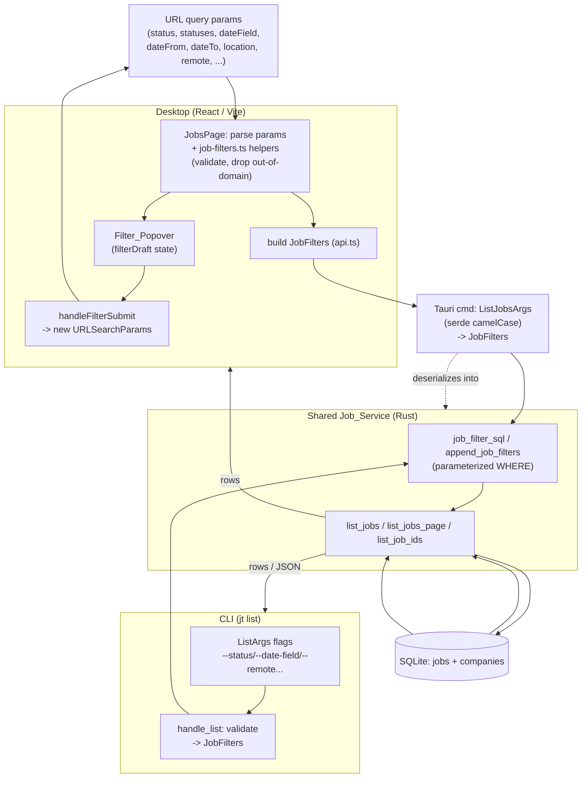

# Design Document

## Overview

This feature extends the Job Tracker live list filtering to add three new, independently selectable, and combinable dimensions on top of the existing filters (search, posting-state, salary, favorites, archived):

1. **Multi-select status** — restrict the list to jobs whose status is any one of a selected set of `Job_Status` values.
2. **Date range by selectable field** — restrict by an inclusive calendar-day range on one of `appliedAt`, `postingDate` (the job's `createdAt`), or `lastCheckedAt`.
3. **Location text + remote mode** — restrict by a case-insensitive substring match against `location` and/or a `remoteOnly` / `onsiteOnly` remote mode.

All three dimensions are additive (conjunctive) with each other and with the existing filters, are encoded in the URL so views are shareable/restorable, follow the existing Filter_Popover UX, and flow through the one shared Rust `Job_Service` so the CLI (`jt list`) and the Tauri IPC path produce identical results against the same database.

### Design goals and constraints

- **Single source of filtering truth.** All three call sites (`list_jobs`, `list_jobs_page`, `list_job_ids`) already consume `job_filter_sql`. New predicates are added there once; the GUI, CLI, and bulk-selection paths inherit them automatically (Req 4.3, 6.5).
- **Backend stays Rust + SQLite.** No Node/Next server, no new HTTP/MCP surface (per `AGENTS.md`). The CLI mirrors the shared service and continues to refresh the CSV mirror on mutations (this feature is read-only, so no CSV impact).
- **Parameterized SQL only.** Every user-supplied value is bound as a `Box<dyn ToSql>` param. No user text is interpolated into SQL strings (the existing `format!` usages inject only static column/operator fragments, never user values).
- **Additive, backward-compatible payload.** The existing single `status` field (used by the sidebar single-select and the applied-tab/pagination logic) is preserved. A new `statuses` field carries the multi-select popover selection. Precedence between them is defined explicitly below.
- **Pure, testable helpers.** Parsing/encoding, validation, and predicate logic live in small pure functions (Rust and TS) so they can be covered by property-based tests without a database or a DOM.

### Research summary

Key findings from reading the current code that shaped this design:

- `JobFilters` (`src-tauri/src/jobs/service.rs`) is a plain `#[derive(Clone, Default)]` struct. `ListJobsArgs` (`src-tauri/src/commands/mod.rs`, `#[serde(rename_all = "camelCase")]`) is the IPC wire type with a `From<ListJobsArgs> for JobFilters` impl. The TS mirror is `JobFilters` in `desktop/src/lib/api.ts`. Adding a filter dimension means touching all three in lockstep.
- `append_job_filters` builds ` AND ...` fragments against a ` WHERE 1=1` base. Status is currently a single equality (`j.status = ?`). Salary already demonstrates the NULL-exclusion pattern this design reuses for dates and location (`AND (col IS NOT NULL ...)`).
- The **applied tab** and **cursor pagination** key off `filters.status.as_deref() == Some("applied")` in `list_jobs_page`. This is why multi-status must be a *separate* field — collapsing the sidebar's single `status` into the multi-set would break applied-tab sort/cursor behavior. See "Applied-tab and pagination interaction" below.
- Statuses are validated by `is_job_status` in `crate::models`; the canonical list also exists on the TS side as `jobStatuses` in `desktop/src/lib/schema.ts`. `RemoteMode` (`any | remoteOnly | onsiteOnly`) already exists in `schema.ts`.
- Timestamps are ISO-8601 strings (`now_iso`, chrono). ISO-8601 strings in a fixed `YYYY-MM-DDTHH:MM:SS...` shape sort lexicographically in the same order as chronologically, so a string `>=`/`<=` comparison against a computed day-boundary string is a correct inclusive range test (detailed under Data Models).
- Existing helper libs (`desktop/src/lib/job-filters.ts`) are unit-tested with vitest; the Rust service has `mod tests` exercising `job_filter_sql`. New pure helpers will follow these patterns.

## Architecture

### Filter data flow

The URL query string is the single persistent source of Filter_State on the GUI side. `JobsPage` parses it into a typed draft, the Filter_Popover edits a draft copy, and submitting writes a fresh `URLSearchParams` back to the URL. A `useEffect` keyed on the parsed params rebuilds a `JobFilters` payload and calls the Tauri command. The CLI builds the same `JobFilters` from flags. Both paths converge on `job_filter_sql`.



### Layering

- **Encoding / decoding (pure).** `job-filters.ts` gains helpers to parse and serialize the status set, date range, and location/remote values to and from `URLSearchParams`, dropping duplicate and out-of-domain values on read (Req 1.6, 5.6). The CLI side parses flags in `handle_list`.
- **Validation (pure).** Date range validation (valid `YYYY-MM-DD`, start ≤ end) lives in a pure helper shared conceptually by GUI and CLI; the GUI surfaces messages in the popover (Req 2.7, 2.8), the CLI exits nonzero (Req 6.7).
- **Query construction (Rust).** `append_job_filters` gains three new fragment builders. This is the only place that touches SQL.
- **Remote-mode predicate (pure, mirrored).** The remote-indicator match is expressed once as a SQL fragment (for query-time filtering) and documented as a pure predicate so it can be property-tested directly in Rust.

## Components and Interfaces

### 1. `JobFilters` (Rust) — `src-tauri/src/jobs/service.rs`

Add fields (all optional, defaulting to `None` so existing callers compile unchanged):

```rust
#[derive(Clone, Default)]
pub struct JobFilters {
    pub status: Option<String>,          // existing: single-select sidebar / applied tab
    pub statuses: Option<Vec<String>>,   // NEW: multi-select; already validated members only
    pub company_id: Option<String>,
    pub posting_state: Option<String>,
    pub search: Option<String>,
    pub salary_min: Option<i64>,
    pub salary_max: Option<i64>,
    pub location: Option<String>,
    pub remote_mode: Option<String>,     // NEW: "any" | "remoteOnly" | "onsiteOnly"
    pub date_field: Option<String>,      // NEW: "appliedAt" | "postingDate" | "lastCheckedAt"
    pub date_from: Option<String>,       // NEW: "YYYY-MM-DD"
    pub date_to: Option<String>,         // NEW: "YYYY-MM-DD"
    pub new_from_watch: Option<bool>,
    pub is_favorite: Option<bool>,
    pub is_archived: Option<bool>,
    pub limit: Option<usize>,
}
```

Contract notes:
- `statuses`, when `Some`, is already normalized to **valid, de-duplicated** `Job_Status` members. All domain validation and the "all-invalid rejected / some-invalid dropped" policy (Req 1.8, 1.9) happen in the caller (IPC boundary or CLI handler) *before* constructing `JobFilters`, so `append_job_filters` can trust its input and stays a pure SQL builder.
- `date_field` must be one of the three supported values when `date_from`/`date_to` are present; the caller validates the field name and date shape.
- `remote_mode == Some("any")` is treated identically to `None` (no restriction, Req 3.7).

### 2. Status-set resolution helper (Rust) — `service.rs` or `models.rs`

A pure function used by both the IPC boundary and the CLI handler so the policy is identical:

```rust
/// Split requested status values into (valid_unique_members, invalid_values),
/// preserving first-seen order and dropping duplicates.
pub fn partition_statuses(requested: &[String]) -> (Vec<String>, Vec<String>);
```

- GUI/IPC policy (Req 1.8, 1.9): if `valid` is non-empty, apply `valid` and ignore `invalid`. If every value is invalid, return an error ("no valid Job_Status value was provided") and leave prior Filter_State untouched.
- CLI policy (Req 1.10, 6.6): if `invalid` is non-empty at all, exit nonzero, name the first invalid value, and emit no rows. (The CLI is stricter by requirement.)

### 3. `append_job_filters` SQL fragments (Rust)

New fragments appended within the existing builder, each parameterized:

**Multi-status** (Req 1.2, 1.3, 4.3). Applied only when `statuses` is `Some` and non-empty, and combined conjunctively with any single `status`:

```rust
if let Some(statuses) = &filters.statuses {
    if !statuses.is_empty() {
        let placeholders = statuses.iter().map(|_| "?").collect::<Vec<_>>().join(", ");
        sql.push_str(&format!(" AND j.status IN ({placeholders})"));
        for s in statuses {
            values.push(Box::new(s.clone()));
        }
    }
}
```

**Date range** (Req 2.3–2.6, 2.11, 2.12). Applied only when `date_field` is present together with at least one bound. Maps the field to a column and excludes NULLs on that field:

```rust
// column = match date_field { "appliedAt" => "j.applied_at",
//   "postingDate" => "j.created_at", "lastCheckedAt" => "j.last_checked_at" }
if let (Some(col), true) = (date_column(filters.date_field.as_deref()),
                            filters.date_from.is_some() || filters.date_to.is_some()) {
    sql.push_str(&format!(" AND {col} IS NOT NULL"));           // Req 2.6: exclude unset field
    if let Some(start_boundary) = &filters.date_from_boundary { // ">= start-of-day"
        sql.push_str(&format!(" AND {col} >= ?"));
        values.push(Box::new(start_boundary.clone()));
    }
    if let Some(end_boundary) = &filters.date_to_boundary {     // "<= end-of-day"
        sql.push_str(&format!(" AND {col} <= ?"));
        values.push(Box::new(end_boundary.clone()));
    }
}
```

`date_column` is a static map (no user value reaches SQL text). Boundary strings are precomputed from the `YYYY-MM-DD` inputs (see Data Models) and bound as params.

**Location text** — the existing branch already satisfies Req 3.3/3.4; it is extended with NULL exclusion so remote/text filters never return location-less jobs (Req 3.9):

```rust
if !watch_path {
    let has_text = filters.location.as_deref().map(|s| !s.trim().is_empty()).unwrap_or(false);
    let has_remote = matches!(filters.remote_mode.as_deref(), Some("remoteOnly") | Some("onsiteOnly"));
    if has_text || has_remote {
        sql.push_str(" AND j.location IS NOT NULL");             // Req 3.9
    }
    if let Some(loc) = filters.location.as_deref().map(str::trim).filter(|s| !s.is_empty()) {
        sql.push_str(" AND j.location LIKE ? ESCAPE '\\'");       // Req 3.3 (case-insensitive via LIKE)
        values.push(Box::new(format!("%{}%", escape_like(loc))));
    }
}
```

**Remote mode** (Req 3.5, 3.6). The four indicator terms are matched case-insensitively. SQLite `LIKE` is case-insensitive for ASCII by default, which covers the indicator terms:

```rust
const REMOTE_TERMS: [&str; 4] = ["remote", "anywhere", "work from home", "wfh"];
match filters.remote_mode.as_deref() {
    Some("remoteOnly") => {
        // at least one term present
        let ors = REMOTE_TERMS.iter().map(|_| "j.location LIKE ?").collect::<Vec<_>>().join(" OR ");
        sql.push_str(&format!(" AND ({ors})"));
        for t in REMOTE_TERMS { values.push(Box::new(format!("%{t}%"))); }
    }
    Some("onsiteOnly") => {
        // none of the terms present
        for t in REMOTE_TERMS {
            sql.push_str(" AND j.location NOT LIKE ?");
            values.push(Box::new(format!("%{t}%")));
        }
    }
    _ => {} // "any" or None: no restriction (Req 3.7)
}
```

(The `j.location IS NOT NULL` guard above ensures `onsiteOnly` still excludes location-less jobs rather than letting `NOT LIKE` on NULL pass through, satisfying Req 3.9.)

### 4. IPC boundary — `ListJobsArgs` + `From` impl (`src-tauri/src/commands/mod.rs`)

`ListJobsArgs` gains the matching camelCase fields: `statuses: Option<Vec<String>>`, `remote_mode: Option<String>`, `date_field`, `date_from`, `date_to`. The `From<ListJobsArgs> for JobFilters` impl is where GUI-policy status partitioning and date validation run:

- Resolve `statuses` via `partition_statuses`; if all invalid, return the Req 1.9 error.
- Validate `date_field` ∈ domain and dates via the shared date validator; on invalid date / start>end, return an error (the GUI pre-validates in the popover, but the boundary is defended here too).
- Compute the day-boundary strings once and store them on `JobFilters`.

Because all three list commands (`list_jobs_cmd`, `list_jobs_page_cmd`, `list_job_ids_cmd`) take `Option<ListJobsArgs>` and call `.into()`, they inherit the new behavior with no further change.

### 5. CLI — `ListArgs` (`src-tauri/src/cli/args.rs`) + `handle_list` (`handlers.rs`)

Add flags to `ListArgs`:

```rust
/// Repeatable or comma-separated: --status applied --status interviewing, or --status applied,interviewing
#[arg(long, value_delimiter = ',', num_args = 1..)]
pub status: Vec<String>,                 // was Option<String>; clap collects repeats + comma-split
#[arg(long, help = "Date field: appliedAt | postingDate | lastCheckedAt")]
pub date_field: Option<String>,
#[arg(long, help = "Start date YYYY-MM-DD (inclusive)")]
pub date_from: Option<String>,
#[arg(long, help = "End date YYYY-MM-DD (inclusive)")]
pub date_to: Option<String>,
#[arg(long, help = "Remote mode: any | remoteOnly | onsiteOnly")]
pub remote: Option<String>,
// existing: company, search, location, favorites, archived, limit
```

`handle_list` performs strict CLI validation (Req 1.10, 3.13, 6.6, 6.7) before building `JobFilters`:
1. If any `--status` value is not a member → error naming the value, nonzero exit, no rows.
2. If `--remote` set and not a `RemoteMode` member → error, nonzero exit, no rows.
3. If `--date-field` set and not a member, or a supplied date is malformed, or `date_from > date_to` → error naming the bad input, nonzero exit, no rows.

Validation returning `Err(AppError)` naturally yields a nonzero exit and prints nothing to the results stream, matching the existing CLI error contract. Multiple `--status` members map to `statuses`; a single `--status` member maps to `statuses` with one element (the CLI has no sidebar/applied-tab notion, so it does not use the single `status` field).

The applied-tab default `is_archived` logic in `handle_list` is generalized: an *explicit* status selection (now a non-empty `statuses`) continues to suppress the default active-pipeline `is_archived = Some(false)` so that `--status closed` etc. are not hidden.

### 6. TS `JobFilters` + `api.ts`

```ts
export type JobFilters = {
  status?: string;            // single (sidebar / applied tab)
  statuses?: string[];        // NEW multi-select
  companyId?: string;
  postingState?: string;
  search?: string;
  salaryMin?: number;
  salaryMax?: number;
  location?: string;
  remoteMode?: RemoteMode;    // NEW
  dateField?: "appliedAt" | "postingDate" | "lastCheckedAt"; // NEW
  dateFrom?: string;          // NEW YYYY-MM-DD
  dateTo?: string;            // NEW YYYY-MM-DD
  newFromWatch?: boolean;
  isFavorite?: boolean;
  isArchived?: boolean;
  limit?: number;
};
```

Serde `rename_all = "camelCase"` already maps `statuses`→`statuses`, `remoteMode`→`remote_mode`, `dateField`→`date_field`, `dateFrom`→`date_from`, `dateTo`→`date_to`.

### 7. `JobsPage.tsx` + `job-filters.ts`

New pure helpers in `job-filters.ts`:

```ts
export function parseStatusesFromUrl(params: URLSearchParams): JobStatus[];     // dedupe + drop non-members
export function encodeStatusesToUrl(params: URLSearchParams, statuses: JobStatus[]): void;
export function isValidCalendarDate(value: string): boolean;                     // strict YYYY-MM-DD
export function validateDateRange(from: string, to: string): string | null;      // null = ok
export function parseDateFilterFromUrl(params: URLSearchParams): { field?: DateField; from: string; to: string };
export function parseRemoteModeFromUrl(params: URLSearchParams): RemoteMode;      // non-member -> "any"
```

- `JobDraft` (the popover draft) extends `JobFilterDraft` with `statuses: JobStatus[]`, `dateField`, `dateFrom`, `dateTo`, `location`, `remoteMode`.
- `handleFilterSubmit` validates the date range first (reusing the salary-error pattern). On invalid date or start>end, it sets `filterError` and returns **without** calling `setSearchParams`, so the current applied Filter_State is retained (Req 2.7, 2.8). Otherwise it writes the status set, date triple, location, and remote-mode params (omitting empties), preserving sort, favorites, and archived (Req 5.3, 5.4).
- The restore effect parses params through the helpers, dropping malformed/out-of-domain values without throwing (Req 5.6, 1.6).
- `activeFilterCount` is extended by the number of *active new dimensions* (0–3): status set non-empty, date filter active (field + ≥1 bound), location active (non-empty text or non-`any` remote), added to the existing salary/posting count (Req 4.6).

### 8. URL parameter scheme

| Dimension | Param(s) | Encoding | Restore rule |
| --- | --- | --- | --- |
| Multi-status | `statuses` | comma-joined members, each listed at most once (e.g. `statuses=applied,interviewing`) | split on comma, keep members, dedupe (Req 1.5, 1.6) |
| Sidebar single status | `status` (existing) | single value | unchanged; drives applied tab |
| Date field | `dateField` | one of `appliedAt`/`postingDate`/`lastCheckedAt` | drop if not a member |
| Date range | `dateFrom`, `dateTo` | `YYYY-MM-DD` | drop param if not a valid calendar date |
| Location text | `location` | raw text (0–200 chars) | trim; drop if empty |
| Remote mode | `remote` | `remoteOnly`/`onsiteOnly` (omit for `any`) | non-member → `any` |

`statuses` uses a single comma-joined param (not repeated keys) to keep encoding deterministic for the round-trip property; order is normalized to the canonical `jobStatuses` order on encode so equivalent sets produce identical URLs.

### Applied-tab and pagination interaction

`list_jobs_page` derives `applied_tab` from the **single** `status` field (`filters.status.as_deref() == Some("applied")`). This is intentionally left keyed on `status`, not `statuses`:

- The sidebar "Applied" view sets `status=applied` and uses applied-date sort + the applied-aware cursor. That path is unchanged.
- The multi-select popover writes `statuses` and does **not** set `status`. Therefore selecting `{applied, interviewing}` in the popover is **not** an applied tab: `applied_tab` is `false`, posting-date sort/cursor apply, and the `statuses` `IN (...)` predicate restricts rows. This is well-defined and avoids an ambiguous "which status drives the applied cursor" question.
- If both `status=applied` (sidebar) and a `statuses` set are somehow present, they combine conjunctively (`j.status = 'applied' AND j.status IN (...)`), and `applied_tab` stays true. The cursor's `sort_spec`/`applied_tab` equality guard already rejects mismatched cursors, so pagination remains consistent.

Because the new predicates are pure `AND` conditions in the shared `where_sql`, the cursor keyset conditions (appended after them) continue to work unchanged across pages.

## Data Models

### Date boundary mapping (local calendar day → ISO string comparison)

Stored timestamps are ISO-8601 strings produced by `now_iso` in a fixed, zero-padded, lexicographically-sortable shape. For an inclusive local-calendar-day range:

- **Start boundary** for `dateFrom = YYYY-MM-DD`: the first instant of that local day. Represented as the string `"YYYY-MM-DDT00:00:00"` (start of day). The predicate `col >= start_boundary` includes everything at or after midnight local time.
- **End boundary** for `dateTo = YYYY-MM-DD`: the last instant of that local day. Represented as `"YYYY-MM-DDT23:59:59.999999999"` (or, equivalently, `col < next_day_start`). Using an upper string that sorts at or above any same-day timestamp makes `col <= end_boundary` inclusive of the whole end day.

This relies on the invariant that all stored `applied_at`, `created_at`, and `last_checked_at` values share the same ISO layout, so lexicographic order equals chronological order. `applied_at` values entered as bare `YYYY-MM-DD` (e.g. from `jt add --applied-at 2026-08-23`) also compare correctly because `"2026-08-23" >= "2026-08-23T00:00:00"` is false only when the stored value is exactly the date with no time — handled by using `"YYYY-MM-DD"` (no `T`) as the start boundary and `"YYYY-MM-DD\u{10FFFF}"`-style or next-day exclusive upper bound. **Chosen approach:** compute boundaries as

- start = `format!("{from}")` (the bare date; `"2026-08-23"` sorts at or before any `"2026-08-23T..."` and equals a bare-date value), and
- end = `format!("{to}~")` where `~` (0x7E) sorts after `T`/digits/`Z`, making every same-day timestamp `<= end`.

Using the local time zone for "today" conversions (CLI `--date-from today` is out of scope; only explicit `YYYY-MM-DD` is accepted) keeps the mapping deterministic.

### Date field → column map

| Date_Field (wire) | SQLite column |
| --- | --- |
| `appliedAt` | `j.applied_at` |
| `postingDate` | `j.created_at` |
| `lastCheckedAt` | `j.last_checked_at` |

### Remote indicator terms

Fixed set, matched case-insensitively as substrings of `location`: `remote`, `anywhere`, `work from home`, `wfh`.

### Status domain

The eight `Job_Status` values (`wishlist`, `applied`, `interviewing`, `offer`, `rejected`, `withdrawn`, `closed`, `archived`), validated by `is_job_status` (Rust) and `jobStatuses` (TS). Encoding normalizes to this canonical order.

### LIKE escaping

Location text is wrapped as `%...%` with `_`, `%`, and `\` escaped and `ESCAPE '\'` appended so user text containing LIKE wildcards matches literally. A small `escape_like` helper performs this; it is a pure function and is property-tested.

## Correctness Properties

*A property is a characteristic or behavior that should hold true across all valid executions of a system — essentially, a formal statement about what the system should do. Properties serve as the bridge between human-readable specifications and machine-verifiable correctness guarantees.*

The following properties were derived from the acceptance criteria via the prework analysis, then consolidated to remove redundancy (empty/single/multi status cases fold into one membership property; all URL encode/restore criteria fold into one round-trip property; the per-bound date criteria fold into one inclusive-range property; and so on).

### Property 1: Status-set membership filtering

*For any* set of jobs and *any* subset `S` of valid `Job_Status` values, the result of applying the multi-status filter equals exactly the jobs whose status is a member of `S`; and when `S` is empty the result equals the full job set (no restriction).

**Validates: Requirements 1.2, 1.3, 1.4, 1.7**

### Property 2: Mixed-validity status partition

*For any* list of status tokens containing at least one valid `Job_Status` member, resolving the Status_Filter yields the deduplicated set of its valid members (first-seen order) and discards every non-member, and the applied filter uses exactly that valid set.

**Validates: Requirements 1.8**

### Property 3: URL Filter_State round-trip and normalization

*For any* valid Filter_State (status set, date field + range, location text, remote mode, plus existing filters), encoding it to URL query parameters and then decoding yields a Filter_State equal to the original normalized form; each status value appears at most once; an inactive dimension encodes to the absence of its parameter and decodes back to inactive.

**Validates: Requirements 1.5, 1.6, 2.9, 2.10, 3.10, 3.11, 5.1, 5.2, 5.5**

### Property 4: Restore robustness against malformed input

*For any* arbitrary map of URL query parameter strings, decoding the Filter_State never throws and yields only in-domain values: status values restricted to `Job_Status` members, a date field restricted to the three supported fields, dates restricted to valid `YYYY-MM-DD` calendar dates, and a remote mode restricted to the `Remote_Mode` set (non-members falling back to `any`).

**Validates: Requirements 5.6, 1.6**

### Property 5: Date-range inclusivity with null exclusion

*For any* set of jobs and *any* selected date field with an optional start date and optional end date, the result equals exactly the jobs whose stored value for that field is non-null and falls at or after the start-of-day boundary of the start date (when present) and at or before the end-of-day boundary of the end date (when present), in the user's local calendar day; jobs with no stored value for the selected field are always excluded when any bound is active.

**Validates: Requirements 2.3, 2.4, 2.5, 2.6, 2.11, 2.12**

### Property 6: Date-range validation

*For any* pair of supplied start and end dates, the validator rejects the input (produces a validation error) if and only if either date is not a valid `YYYY-MM-DD` calendar date or the start date is strictly later than the end date.

**Validates: Requirements 2.7, 2.8**

### Property 7: Location-text substring match

*For any* set of jobs and *any* location query text, applying the location-text filter with non-empty, non-whitespace text returns exactly the jobs whose non-null `location` contains the query as a case-insensitive substring (treating LIKE wildcards in the query as literal characters); applying it with empty or whitespace-only text imposes no location-text restriction.

**Validates: Requirements 3.3, 3.4, 3.9**

### Property 8: Remote-mode predicate

*For any* set of jobs, applying `remoteOnly` returns exactly the jobs whose non-null `location` contains at least one remote indicator term (`remote`, `anywhere`, `work from home`, `wfh`) case-insensitively; applying `onsiteOnly` returns exactly the jobs whose non-null `location` contains none of those terms; applying `any` imposes no remote restriction. Jobs with no stored `location` are excluded under `remoteOnly` and `onsiteOnly`.

**Validates: Requirements 3.5, 3.6, 3.7, 3.9**

### Property 9: Conjunctive composition

*For any* set of jobs and *any* combination of active filters drawn from {status set, date range, location text, remote mode} together with the existing {search, posting-state, salary, favorites, archived} filters, the combined result equals the intersection of the results each active filter would produce when applied alone.

**Validates: Requirements 3.8, 4.1, 4.2, 4.3**

### Property 10: Order-independence (confluence)

*For any* Filter_State, reordering the selected status values (and any other order-insensitive filter inputs) produces an identical set of jobs.

**Validates: Requirements 4.4**

### Property 11: Active-filter count

*For any* Filter_State, the active-filter indicator count equals the number of active new dimensions among {status set non-empty, date filter active, location filter active} — each counted at most once, yielding 0 to 3 — added to the count contributed by the existing active-filter indicators.

**Validates: Requirements 4.6**

### Property 12: CLI / IPC parity

*For any* `JobFilters` value, the jobs returned through the shared `Job_Service` are identical regardless of whether the equivalent Filter_State was supplied via the CLI `list` flags or the Tauri IPC path, because both construct the same `JobFilters` and execute the same `job_filter_sql` query.

**Validates: Requirements 6.1, 6.2, 6.3, 6.5**

## Error Handling

Errors are classified by where the invalid input originates, and each path has a distinct, requirement-driven contract.

### GUI / popover validation (retain state, no error dialog)

- **Invalid or out-of-order dates (Req 2.7, 2.8).** `handleFilterSubmit` runs `validateDateRange` before writing the URL. On failure it sets `filterError` with a human-readable message ("Start date must not be later than the end date." / "Enter a valid date in YYYY-MM-DD form.") and returns early **without** calling `setSearchParams`, so the currently applied Filter_State is preserved and the Date_Filter is not applied. This mirrors the existing salary-range validation flow.
- **Malformed / out-of-domain params on load (Req 5.6, 1.6).** The restore helpers are total functions: non-member statuses and remote modes are dropped (remote → `any`), invalid dates are dropped, and an unknown date field is dropped. Parsing never throws; remaining valid filters restore normally.

### IPC boundary (defensive, additive)

- **All-invalid status set (Req 1.9).** `From<ListJobsArgs>`/the command resolves statuses via `partition_statuses`. If every provided value is a non-member, it returns an `AppError` ("No valid Job_Status value was provided"); the caller leaves the previously applied Status_Filter in place. When at least one member exists, invalid values are silently dropped (Req 1.8).
- The GUI normally pre-validates, so these boundary checks are defense-in-depth for programmatic callers.

### CLI (strict: nonzero exit, named value, no rows)

- **Invalid status / date field / remote mode (Req 1.10, 3.13, 6.6).** `handle_list` validates each option against its domain before querying. Any non-member produces an `AppError` that names the rejected option and value; the command returns `Err`, which the CLI entry point renders to stderr and maps to a nonzero exit code, emitting no results to stdout.
- **Invalid or out-of-order dates (Req 6.7).** Same pattern using the shared date validator; the error names the offending date input.
- Because validation happens before any `list_jobs` call, no partial or empty result set is printed as if it were a successful query.

### SQL safety

- All user-supplied values (status members, date boundaries, location text, remote term patterns) are bound as parameters. The only `format!`-interpolated fragments are the fixed `IN (?, ?, …)` placeholder list (count derived from the validated status set length), static column names from the `date_column` map, and static operators — never user text. LIKE patterns escape `%`, `_`, and `\` with `ESCAPE '\'`.

## Testing Strategy

### Dual approach

- **Property-based tests** verify the universal properties above across randomized inputs. PBT is appropriate here because the core logic is pure and input-driven: set membership, string substring/predicate matching, boundary comparison, URL encode/decode round-trips, and query-result intersection. These have clear "for all inputs" statements and large input spaces (arbitrary status token lists, timestamps near day boundaries, location strings with wildcards and mixed case, arbitrary URL param maps).
- **Unit / example tests** cover concrete UI rendering (popover controls — Req 1.1, 2.1, 2.2, 3.1, 3.2), the empty-result state (Req 4.5), sort/favorites/archived preservation on submit (Req 5.3, 5.4), CLI error exit codes and messages (Req 1.10, 3.13, 6.6, 6.7), and CLI `--json` output shape (Req 6.4).
- **Integration tests** (Rust, in-memory SQLite) seed a small `jobs`/`companies` fixture and assert the end-to-end query behavior for representative filter combinations, anchoring the pure-logic properties to real SQL execution.

### Libraries

- **Rust:** `proptest` for property tests of `partition_statuses`, the date boundary mapping, the remote/location predicates expressed as pure Rust functions mirroring the SQL, the conjunction/intersection over an in-memory job model, and CLI/IPC parity (constructing `JobFilters` and running `list_jobs` against an in-memory DB). Do not hand-roll generators where `proptest` combinators suffice.
- **TypeScript:** `fast-check` with `vitest` for the `job-filters.ts` helpers: status parse/encode round-trip, `isValidCalendarDate` / `validateDateRange`, remote-mode parse, the robustness-against-arbitrary-input property, and `activeFilterCount`.

### Configuration and tagging

- Each property test runs a **minimum of 100 iterations** (`proptest` `ProptestConfig { cases: 100, .. }`; `fast-check` `{ numRuns: 100 }`).
- Each property test is implemented as a **single** property-based test and tagged with a comment referencing its design property, in the form:
  `// Feature: enhanced-filters, Property {number}: {property_text}`
- Mapping of properties to primary test homes:
  - P1, P2 → Rust (`partition_statuses`, membership over in-memory model) + TS (status parse).
  - P3, P4, P6, P11 → TS (`fast-check`) in `job-filters.test.ts`.
  - P5, P7, P8, P9, P10, P12 → Rust (`proptest`) in `service.rs` tests against in-memory SQLite.
- Generators must include edge inputs so they are exercised without separate hardcoded cases: empty status set, duplicate and non-member status tokens, bare-date vs full-ISO timestamps, timestamps at `00:00:00` and end-of-day, location strings containing `%`/`_`/mixed case/indicator-term substrings (e.g. "Greater Remoteville" to probe substring semantics), null locations, and absent/garbage URL params.

### Out of scope for PBT

- Visual/layout concerns and the exact wording of the empty-state message are example/component tests, not properties.
- The claim that predicates live "within `job_filter_sql`" (Req 4.3) is verified behaviorally by the conjunction property; it is not a separate runtime property.
